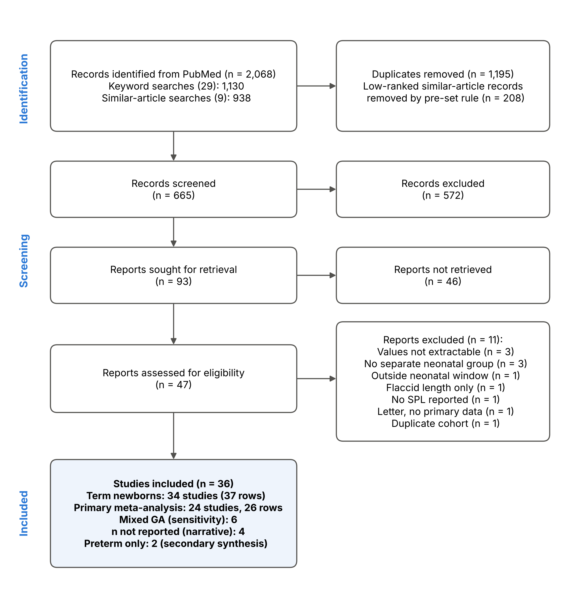
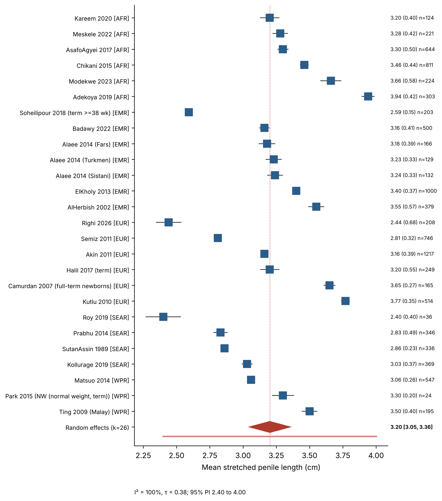
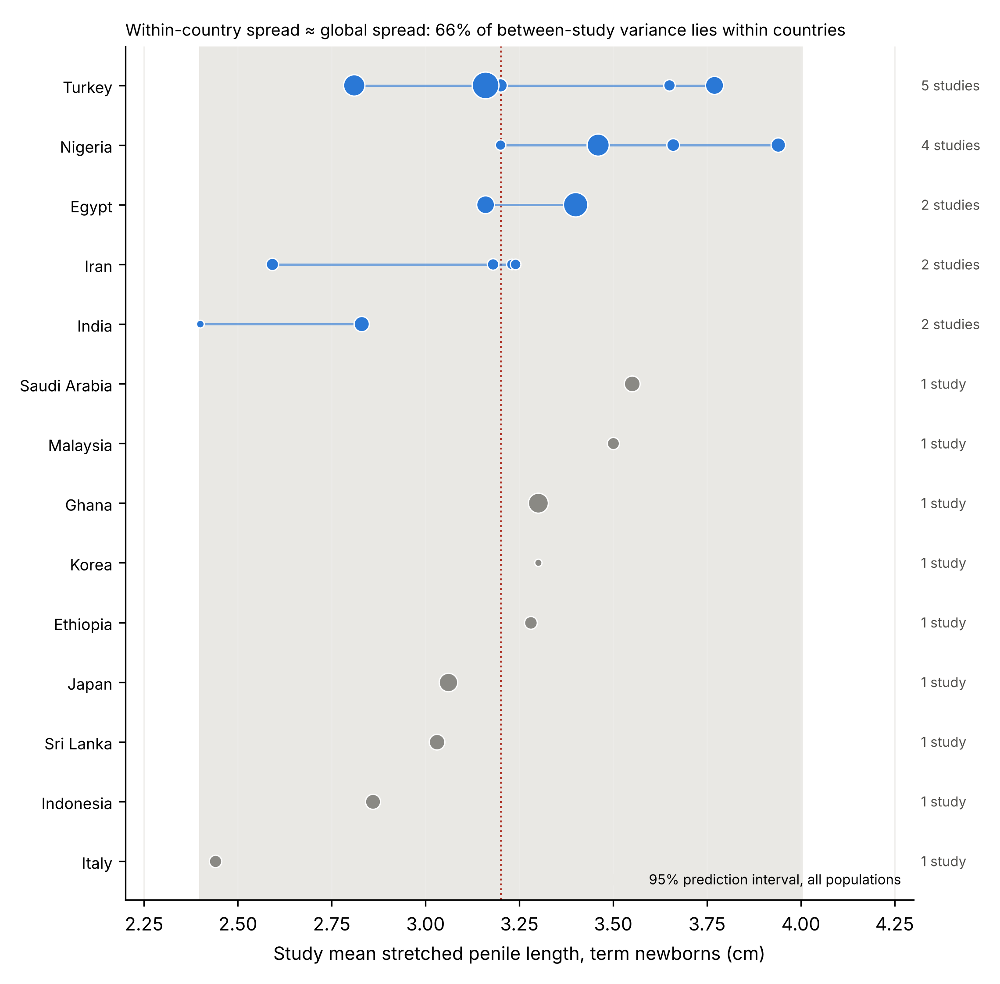
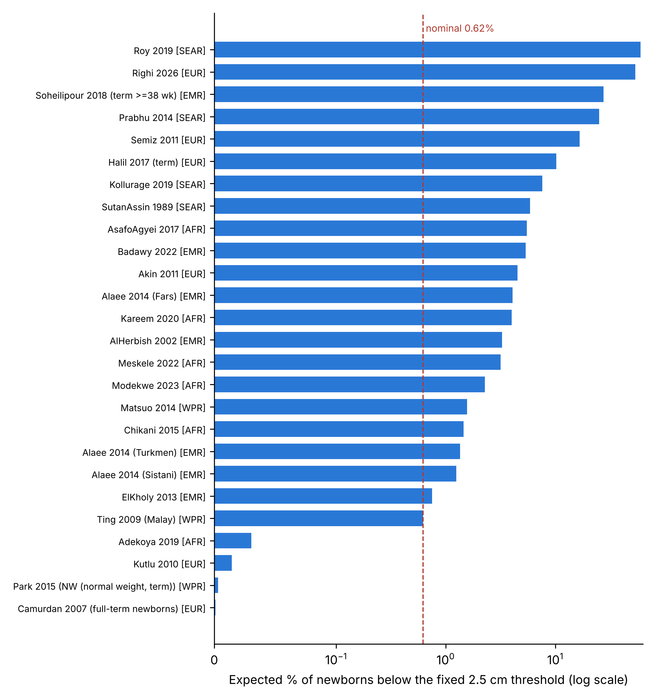

> **Note to authors — complete before submission**
>
> 1. Screening and extraction used an AI-assisted workflow, PubMed only, with a single extractor. Every value is stored with its verbatim source in `data/term_extraction.csv`, and the full-text excerpts are in `data/fulltext_verbatim_notes.md`.
> 2. Two independent reviewers must repeat screening and extraction and complete the JBI appraisal (Supplementary Table S3 template). Revise the Methods accordingly.
> 3. Extend the search to Embase, Scopus, LILACS, CNKI and grey literature. In particular, obtain the full texts for the 23 abstract-only studies and for the large cohorts not retrievable here: Fok 2005 (n = 4,628), Bhakhri 2014 (n = 1,249), Romano-Riquer 2007 (n = 781), and the Boas 2006 birth-measurement n.
> 4. Register in PROSPERO, or declare the review unregistered.
> 5. Disclose AI assistance.

# Stretched penile length in term newborns across 26 populations: a systematic review and meta-analysis showing that local method, more than ancestry, drives between-population variation

**Authors:** [Author 1]^1^, … [Senior author]^1^

^1^ [Department of Pediatric Endocrinology, Institution, City, Country]

**Correspondence:** [name, e-mail]

**Word count:** ~4,800; **Tables:** 3; **Figures:** 4

---

## Abstract

**Background.** Micropenis in the newborn is diagnosed against a reference mean and SD. The classic 2.5 cm cut-off is applied worldwide, although many populations have since published their own values. Whether between-population differences reflect ancestry or method has never been examined quantitatively.

**Methods.** We searched PubMed from inception to 18 November 2026 for primary studies reporting stretched penile length (SPL) in healthy term newborns (≥37 weeks) measured within 28 days of birth. Analysis proceeded in five steps:

1. Means and within-population SDs were pooled with random-effects models (REML; Hartung–Knapp CIs; 95% prediction intervals).
2. Heterogeneity was explored by WHO region, publication year, technique and source.
3. The heterogeneity was partitioned into within-country and between-country components.
4. The expected proportion of newborns falling below a fixed 2.5 cm threshold was estimated for each population.
5. Preterm data were synthesised descriptively.

**Results.** Thirty-six studies were included. The primary analysis comprised 24 studies, 26 populations and 9,788 term newborns from 14 countries (1989–2026).

- *Pooled mean.* The pooled mean SPL was 3.20 cm (95% CI 3.05–3.36). The prediction interval for the mean of a new population was wide, 2.40–4.00 cm, with between-population SD τ = 0.38 cm. This equals the pooled within-population SD of 0.38 cm (95% CI 0.33–0.43).
- *Region.* WHO region explained 19% of between-study variance. South-East Asian populations had the lowest mean (2.79 cm).
- *Within-country variance.* Among countries with two or more studies, 66% of between-study variance lay within countries. In Turkey alone, five study means ranged from 2.81 to 3.77 cm.
- *Other covariates.* Publication year, described fat-pad depression and full-text availability were not associated with the mean.
- *Fixed 2.5 cm threshold.* Under normality, this threshold classified a median of 3.6% of newborns as micropenic (range <0.01% to 60%), against the nominal 0.62%. The proportion exceeded 2% in 16 of 26 populations.
- *Sensitivity analysis.* Excluding six samples with measurement concerns gave a pooled mean of 3.30 cm (3.17–3.43) and τ = 0.28 cm.

Certainty was low.

**Conclusions.** Between-population variation in newborn SPL is as large as within-population variation, and most of it is local rather than geographic. Neither a single global cut-off nor an ancestry-matched reference can be trusted unless method is standardised. Units that diagnose micropenis should adopt a standardised technique and validate a technique-matched local reference.

**Keywords:** stretched penile length; micropenis; newborn; reference values; meta-analysis; heterogeneity; ethnicity; measurement

### What is already known

- Micropenis is defined as SPL below −2.5 SD. The 2.5 cm cut-off derives from references obtained in single populations.
- Many national newborn SPL studies report means that differ from the classic values.

### What this study adds

- Across 26 populations, the between-population SD of mean SPL (0.38 cm) equals the within-population SD. The fixed 2.5 cm threshold labels between 0% and 60% of newborns, depending on the population.
- Two-thirds of the between-study variance lies within countries, which points to local method rather than ancestry.

---

## 1. Introduction

Stretched penile length (SPL) is measured in the newborn period for a single purpose: to identify the boy whose penis is abnormally small, because micropenis may be the first sign of congenital hypogonadotropic hypogonadism, combined pituitary hormone deficiency or a difference of sex development [@Lee2006; @Hatipoglu2013; @Boehm2015]. The neonatal period is the moment of greatest diagnostic leverage. In the first months of life the hypothalamic–pituitary–gonadal axis is physiologically active, and gonadotropin deficiency can be confirmed directly [@KuiriHanninen2014; @Grumbach2005]. Early gonadotropin replacement is under active investigation [@Bouvattier2011].

The diagnostic threshold is conventionally 2.5 SD below the mean. A threshold defined in this way is only as good as the reference that supplies the mean and the SD.

The reference most often quoted is half a century old. Feldman and Smith reported a stretched length of "3.5 cm plus or minus 0.7 cm" in term newborns [@Feldman1975]. The widely taught absolute cut-off of 2.5 cm corresponds to −2.5 SD only if the SD is 0.4 cm, a value later reported in 1,962 Danish and Finnish boys (3.49 ± 0.4 cm) [@Boas2006]. Since then, many national and regional studies have reported newborn SPL, often with means that differ materially from these values [@Matsuo2014]. They have also used techniques that differ in whether, and how firmly, the suprapubic fat pad is depressed.

Population differences matter more than their size might suggest. The diagnosis is made in the extreme tail of the distribution, so a shift of the reference mean by half an SD multiplies or divides the apparent prevalence of micropenis by a factor of about four. This is shown in Paper 4 of this series, a companion Monte Carlo study.

No previous study has synthesised newborn SPL quantitatively across populations. We therefore conducted a systematic review and random-effects meta-analysis with four aims:

1. to estimate the mean and the within-population SD of SPL in healthy term newborns;
2. to quantify between-population heterogeneity, and its association with geographic region, publication period and technique;
3. to derive population-specific −2.5 SD thresholds;
4. to estimate how a single fixed threshold of 2.5 cm misclassifies newborns across populations.

## 2. Methods

The review is reported according to PRISMA 2020 [@Page2021] and the MOOSE guidance for meta-analyses of observational studies [@Stroup2000].

### 2.1 Eligibility

**Included.** Primary studies that reported SPL in healthy male newborns born at term (≥37 weeks' gestation) and measured within the first 28 days of life. Each study had to report a sample size and either a mean or a median.

**Excluded.**

- Reviews.
- Studies restricted to infants with a disease or anomaly.
- Studies reporting only non-stretched (flaccid) length.
- Duplicate reports of the same cohort; in that case the more complete report was retained.

**Secondary eligibility.** Studies reporting SPL by gestational-age band in preterm infants were eligible for a secondary synthesis.

### 2.2 Search and selection

PubMed was searched from inception to 18 November 2026. The search used general and country-specific query strings, supplemented by related-article searches from key studies. The full strategy, dates and hit counts are given in Supplementary File S1. Records were screened by title and abstract, and the full text was obtained from PubMed Central where available.

### 2.3 Data extraction

For each study, or for each subgroup where a study reported more than one population, we extracted:

- country and WHO region;
- population or ethnicity;
- sample size;
- gestational-age criteria;
- age at measurement;
- measurement technique: instrument, and whether depression of the suprapubic fat pad was described;
- the summary statistics reported: mean, SD, SE, median, quartiles, range, and any −2.5 SD value.

Every number was stored with the verbatim sentence or table cell from which it was taken, and with an indicator of whether it came from the full text or only the abstract.

### 2.4 Statistical analysis

**Conversion of summary statistics.** When only a median with quartiles or range was reported, the mean was estimated by the method of Luo et al. [@Luo2018] and the SD by that of Wan et al. [@Wan2014]. An SD was derived from an SE when necessary. Where no measure of dispersion was available, the study contributed to the pooled mean with an imputed SD equal to the median SD of the other studies. Such studies were excluded from the pooled SD, and their influence was tested in sensitivity analysis.

**Pooled mean.** The study-level effect was the mean SPL, with variance SD²/n. Means were pooled with a random-effects model:

- τ² estimated by restricted maximum likelihood [@Viechtbauer2005];
- confidence intervals from the Hartung–Knapp–Sidik–Jonkman method [@Hartung2001; @IntHout2014];
- a 95% prediction interval for the mean of a new population [@Higgins2009; @Riley2011];
- heterogeneity summarised by τ, I² [@Higgins2002] and a Q-profile confidence interval for τ².

**Pooled SD.** The within-population SD was pooled on the log scale. The effect was ln(SD) + 1/[2(n − 1)], with variance 1/[2(n − 1)], using the same random-effects machinery.

**Thresholds and misclassification.** Population-specific −2.5 SD thresholds were computed as mean − 2.5 × SD. For each study with a reported SD, we computed the expected percentage of newborns below the fixed 2.5 cm threshold, Φ[(2.5 − mean)/SD], under normality, and compared it with the nominal 0.62%.

**Sources of heterogeneity.**

- Subgroup analysis by WHO region, tested with Q-between.
- Mixed-effects meta-regression on WHO region, publication year (per decade), explicit description of fat-pad depression, and source level (full text vs abstract), each with Knapp–Hartung t-tests.

**Small-study effects** were examined by funnel plot and Egger's test [@Egger1997] when at least 10 studies were available.

**Robustness** was examined by leave-one-out analysis and by restricting the analysis to four subsets:

- studies with full text;
- studies that described fat-pad depression;
- studies with n ≥ 100;
- studies reporting mean and SD directly.

**Software.** All analyses were performed in Python 3.13 with purpose-written code. The code was validated against the reference implementation in *metafor*, using a standard benchmark dataset: estimates, standard errors, τ² and its Q-profile CI, and meta-regression coefficients all agreed to four decimal places. Code and data are provided as supplementary material.

### 2.5 Risk of bias and certainty

The methodological quality of each study was assessed against the domains of the JBI checklist for prevalence studies, adapted to a continuous normative outcome [@Munn2015]. The domains were:

- sample frame and recruitment;
- adequacy of sample size;
- description of subjects and setting;
- a valid, reliable measurement method, including a described technique and examiner training;
- standard measurement for all participants.

Certainty in the pooled estimates was rated with GRADE, applying the framework for evidence from observational and prognostic or normative estimates [@Guyatt2008; @Iorio2015].

## 3. Results

### 3.1 Study selection

The searches identified 2,068 records: 1,130 from 29 keyword searches and 938 from 9 similar-article searches.

- After removal of 1,195 duplicates, and of 208 low-ranked similar-article records under a rule fixed in advance, 665 records were screened.
- Ninety-three reports were sought. Forty-six could not be assessed, most often because no full text was available and the abstract lacked the required data.
- Of the 47 reports assessed, 11 were excluded (Figure 1; Supplementary Table S2), and 36 studies were included.

Of the 36 included studies:

- 34 reported term newborns, in 37 population rows;
- 2 reported preterm infants only.

Of the 34 term studies:

- 24 (26 population rows; 9,788 newborns) met all criteria for the primary analysis;
- 6 enrolled mixed or unrestricted gestational ages and were used in sensitivity analysis only [@BustamanteMontes2013; @Nanda2023; @Elusiyan2016; @Mondal2016; @Singal2015; @Jarrett2013];
- 4 did not report a usable sample size and are described narratively [@Shah2020; @Lian2000; @Vasudevan1995; @Boas2006].

**Figure 1.** PRISMA 2020 flow diagram.

### 3.2 Study characteristics

The 26 primary populations came from 14 countries in five WHO regions (Table 1). The largest contributors were Turkey (five studies), Nigeria (four), and Iran and Egypt (two each). Publication years ranged from 1989 to 2026.

Twelve of the 26 rows were extracted from full texts and 14 from abstracts only. An anchoring of the measuring instrument at the pubic bone, or fat-pad depression, was described for 14 rows. Age at measurement ranged from the first 24 hours to 28 days. Six rows carried a pre-specified measurement concern (Table 1, footnote).

**Table 1. Populations included in the primary meta-analysis.**

| Study | Country | WHO region | n | Mean (cm) | SD (cm) | −2.5 SD (cm) | % below 2.5 cm* | Source |
|---|---|---|---|---|---|---|---|---|
| Kareem 2020 [@Kareem2020] | Nigeria | AFR | 124 | 3.20 | 0.40 | 2.20 | 4.0 | Full text |
| Meskele 2022 [@Meskele2022]ᶜ | Ethiopia | AFR | 221 | 3.28 | 0.42 | 2.23 | 3.2 | Abstract |
| Asafo-Agyei 2017 [@AsafoAgyei2017] | Ghana | AFR | 644 | 3.30 | 0.50 | 2.05 | 5.5 | Full text |
| Chikani 2015 [@Chikani2014] | Nigeria | AFR | 811 | 3.46 | 0.44 | 2.36 | 1.5 | Abstract |
| Modekwe 2023 [@Modekwe2023]ᶜ | Nigeria | AFR | 224 | 3.66 | 0.58 | 2.21 | 2.3 | Full text |
| Adekoya 2019 [@Adekoya2019] | Nigeria | AFR | 303 | 3.94 | 0.42 | 2.89 | 0.03 | Abstract |
| Soheilipour 2018 [@Soheilipour2018]ᶜ | Iran | EMR | 203 | 2.59 | 0.15 | 2.21 | 27.5 | Full text |
| Badawy 2022 [@Badawy2021] | Egypt | EMR | 500 | 3.16 | 0.41 | 2.14 | 5.4 | Abstract |
| Alaee 2014, Fars [@Alaee2014] | Iran | EMR | 166 | 3.18 | 0.39 | 2.21 | 4.1 | Full text |
| Alaee 2014, Turkmen [@Alaee2014] | Iran | EMR | 129 | 3.23 | 0.33 | 2.41 | 1.3 | Full text |
| Alaee 2014, Sistani [@Alaee2014] | Iran | EMR | 132 | 3.24 | 0.33 | 2.42 | 1.2 | Full text |
| El-Kholy 2013 [@ElKholy2013] | Egypt | EMR | 1,000 | 3.40 | 0.37 | 2.48 | 0.75 | Abstract |
| Al-Herbish 2002 [@AlHerbish2002] | Saudi Arabia | EMR | 379 | 3.55 | 0.57 | 2.13 | 3.3 | Abstract |
| Righi 2026 [@Righi2026]ᶜ | Italy | EUR | 208 | 2.44 | 0.68 | 0.73 | 53.5 | Full text |
| Semiz 2011 [@Semiz2011]ᶜ | Turkey | EUR | 746 | 2.81 | 0.32 | 2.01 | 16.6 | Abstract |
| Akın 2011 [@Akin2011] | Turkey | EUR | 1,217 | 3.16 | 0.39 | 2.19 | 4.5 | Abstract |
| Halil 2017 [@Halil2017] | Turkey | EUR | 249 | 3.20 | 0.55 | 1.82 | 10.2 | Abstract |
| Camurdan 2007 [@Camurdan2007] | Turkey | EUR | 165 | 3.65 | 0.27 | 2.98 | <0.01 | Abstract |
| Kutlu 2010 [@Kutlu2010] | Turkey | EUR | 514 | 3.77 | 0.35 | 2.90 | 0.01 | Full text |
| Roy 2019 [@Roy2019]ᶜ | India | SEAR | 36 | 2.40 | 0.40 | 1.40 | 59.9 | Full text |
| Prabhu 2014 [@Prabhu2014] | India | SEAR | 346 | 2.83 | 0.49 | 1.61 | 25.0 | Full text |
| Sutan-Assin 1989 [@SutanAssin1989] | Indonesia | SEAR | 336 | 2.86 | 0.23 | 2.29 | 5.9 | Abstract |
| Kollurage 2019 [@Kollurage2019] | Sri Lanka | SEAR | 369 | 3.03 | 0.37 | 2.11 | 7.6 | Abstract |
| Matsuo 2014 [@Matsuo2014] | Japan | WPR | 547 | 3.06 | 0.26 | 2.41 | 1.6 | Abstract |
| Park 2015 [@Park2015] | Korea | WPR | 24 | 3.30 | 0.20 | 2.80 | <0.01 | Full text |
| Ting 2009, Malay [@Ting2009] | Malaysia | WPR | 195 | 3.50 | 0.40 | 2.50 | 0.62 | Abstract |

Notes to Table 1:

- \* Expected percentage of newborns below 2.5 cm, under normality, given the study mean and SD. The nominal value is 0.62%.
- ᶜ Pre-specified measurement concern:
  - Soheilipour: implausibly small SD;
  - Righi: gentle traction only, and a very large SD;
  - Roy: trimmed mean, n = 36;
  - Modekwe: measured at 4–28 days, with a suture;
  - Semiz: stretching not stated;
  - Meskele: unit not printed.

### 3.3 Pooled mean and within-population SD

The pooled mean SPL across 26 populations was **3.20 cm** (95% CI 3.05–3.36; Figure 2).

**Heterogeneity.** Heterogeneity was extreme. τ = 0.38 cm, and the Q-profile 95% CI for τ² was 0.089–0.279 cm², corresponding to τ of 0.30–0.53 cm. I² exceeded 99%. The 95% prediction interval for the mean of a new population was **2.40–4.00 cm**.

**Within-population SD.** The pooled within-population SD was **0.38 cm** (95% CI 0.33–0.43; prediction interval 0.19–0.75). Between-population variation in the mean was therefore as large as within-population variation.

**Combined uncertainty.** For an individual newborn in an unstudied population, the SD of the predictive distribution, which combines both sources of variation, was 0.54 cm.

**Pooled threshold.** The pooled-mean −2.5 SD threshold was 2.26 cm. Population-specific thresholds ranged from 1.61 to 2.98 cm among rows without measurement concerns.

**Figure 2.** Forest plot of mean SPL in term newborns, grouped by WHO region. Squares are study means (size proportional to random-effects weight) with 95% CIs. The diamond is the pooled mean, and the horizontal bar beneath it is the 95% prediction interval. The right-hand column shows mean (SD) and n.

### 3.4 Sources of heterogeneity

**By WHO region** (Table 2):

- Mean SPL was lowest in South-East Asian populations: 2.79 cm (95% CI 2.36–3.21).
- It was highest in African populations: 3.47 cm (3.18–3.77).
- Eastern Mediterranean, European and Western Pacific populations were intermediate.
- The test for subgroup differences was significant (Q~between~ = 16.2, df = 4, p = 0.003), but region explained only 19% of between-study variance, and heterogeneity within every region remained extreme (I² ≥ 97.5%).

**Other covariates.** None was associated with the mean:

- publication year: −0.07 cm per decade, 95% CI −0.28 to 0.15;
- described pubic anchoring or fat-pad depression: −0.14 cm, −0.45 to 0.17;
- full-text vs abstract-only source: −0.19 cm, −0.50 to 0.11.

**Table 2. Pooled mean SPL and derived −2.5 SD thresholds by WHO region.**

| Region | k | n | Pooled mean, cm (95% CI) | 95% PI | Pooled SD (cm) | −2.5 SD threshold (cm) |
|---|---|---|---|---|---|---|
| African (AFR) | 6 | 2,327 | 3.47 (3.18–3.77) | 2.63–4.31 | 0.46 | 2.33 |
| Eastern Mediterranean (EMR) | 7 | 2,509 | 3.19 (2.92–3.47) | 2.37–4.01 | 0.35 | 2.33 |
| European (EUR) | 6 | 3,099 | 3.17 (2.65–3.70) | 1.68–4.67 | 0.41 | 2.16 |
| South-East Asian (SEAR) | 4 | 1,087 | 2.79 (2.36–3.21) | 1.53–4.04 | 0.36 | 1.89 |
| Western Pacific (WPR) | 3 | 766 | 3.29 (2.73–3.84) | 0.05–6.52 | 0.28 | 2.58 |
| **All** | 26 | 9,788 | **3.20 (3.05–3.36)** | **2.40–4.00** | **0.38** | **2.26** |

Note: the Western Pacific prediction interval is uninformative because k = 3.

### 3.5 Within-country versus between-country variation

Five countries contributed two or more studies: Turkey 5, Nigeria 4, Iran 2, Egypt 2 and India 2, together accounting for 17 population rows. In this subset:

- Total between-study τ was 0.41 cm.
- After adjustment for country, the residual within-country τ was 0.33 cm.
- **Two-thirds (66%) of the between-study variance therefore lay within countries**, and country explained 34% (Figure 3).

Within-country variation was striking:

- **Turkey.** The five Turkish study means spanned 2.81 to 3.77 cm, nearly the entire global prediction interval [@Semiz2011; @Akin2011; @Halil2017; @Camurdan2007; @Kutlu2010]. Three of the five studies were conducted in the same city.
- **Nigeria.** The four Nigerian means spanned 3.20 to 3.94 cm [@Kareem2020; @Chikani2014; @Modekwe2023; @Adekoya2019].
- **Iran.** Three ethnic groups measured by one team in one province had near-identical means of 3.18–3.24 cm [@Alaee2014], whereas a different Iranian team reported 2.59 cm [@Soheilipour2018].

**Figure 3.** Study means of term-newborn SPL by country. Blue markers are countries with two or more studies, joined by a line; grey markers are single-study countries. Marker area is proportional to n. The shaded band is the 95% prediction interval for all populations, and the dotted line the pooled mean.

### 3.6 Consequences of a fixed 2.5 cm threshold

The expected percentage of newborns falling below 2.5 cm (Table 1; Figure 4) was:

- median 3.6% across the 26 populations;
- more than 2% in 16 populations, i.e. more than three times the nominal 0.62%;
- more than 5% in 10 populations;
- below the nominal value in 4 populations.

Among rows without measurement concerns, the proportion ranged from below 0.01% (Turkey, Ankara) to 25% (India, Chennai).

**Figure 4.** Expected percentage of term newborns with SPL below the fixed 2.5 cm threshold in each population, assuming normality (logarithmic axis). The dashed line marks the nominal 0.62% implied by a −2.5 SD definition.

### 3.7 Sensitivity analyses and small-study effects

The pooled mean was robust to:

- **Leave-one-out analysis:** range 3.17–3.23 cm.
- **Restriction to studies with n ≥ 100:** 3.23 cm (3.08–3.38).
- **Inclusion of the six mixed-gestation samples:** 3.18 cm (3.04–3.32); k = 32.

Restriction to subsets gave:

- **Full-text studies:** 3.10 cm (2.82–3.38); k = 12.
- **Studies describing pubic anchoring:** 3.14 cm (2.89–3.38); k = 14.

**Measurement concerns.** Excluding the six rows with pre-specified measurement concerns raised the mean to 3.30 cm (3.17–3.43) and reduced τ to 0.28 cm (k = 20). Further restriction to full-text studies without concerns gave 3.26 cm (3.04–3.47) and τ = 0.26 cm (k = 8). Even in this most homogeneous subset, between-population SD was about two-thirds of the within-population SD.

**Small-study effects.** Egger's test gave no evidence of small-study effects (p = 0.19), although the test has limited meaning for normative means.

### 3.8 Studies not pooled

**No usable n.** Four term studies could not be pooled because n was not reported for the relevant subgroup. Their means were consistent with the pooled distribution:

- White and African-American newborns in the USA: 3.5 ± 0.5 and 3.6 ± 0.5 cm [@Shah2020];
- Singapore: 3.6 ± 0.4 cm [@Lian2000];
- India: 3.57 ± 0.46 cm [@Vasudevan1995];
- Denmark and Finland: 3.49 ± 0.4 cm [@Boas2006].

**Mixed gestational age.** The six mixed-gestation samples reported means of 2.48–3.40 cm.

**Classic standard.** Feldman and Smith's classic standard (3.5 ± 0.7 cm; n not stated in the abstract) was not eligible for pooling [@Feldman1975].

### 3.9 Preterm infants

Five studies reported preterm data; none could be pooled.

- **By gestational-age band** [@Soheilipour2018]. Mean SPL rose from 1.80 cm at 28–30 weeks to 2.29 cm at 36–38 weeks, a slope of about 0.06–0.07 cm per week. However, the same study reported an implausibly small SD at term.
- **Single preterm groups:**
  - 2.5 ± 0.57 cm at 26–36 weeks [@Halil2017];
  - 2.9 ± 0.4 cm in low-birth-weight infants under 38 weeks [@Park2015];
  - 2.37 ± 0.30 cm below 35 weeks [@Celik2025].
- **Regression only.** A fifth study reported a regression of length on gestational age whose intercept, as printed in the abstract, is implausible [@Tuladhar1998].

### 3.10 Certainty of evidence

Certainty in the pooled mean was rated **low**. It was downgraded for:

- risk of bias: undescribed technique in most abstract-only studies, and convenience sampling;
- inconsistency: τ equal to the within-population SD.

It was not downgraded for imprecision (narrow CI) or for indirectness.

---

## 4. Discussion

### 4.1 Principal findings

This meta-analysis of 26 populations, comprising almost 10,000 term newborns, yields three findings.

1. **The pooled values.** The average newborn SPL is about 3.2 cm, with a within-population SD of about 0.38 cm.
2. **Between-population variation.** The mean varies between populations by as much as individual newborns vary within a population. The prediction interval for a new population's mean spans 2.4 to 4.0 cm. The fixed 2.5 cm threshold therefore labels anywhere from almost no newborns to more than half.
3. **The source of that variation.** Two-thirds of it lies within countries, not between them.

### 4.2 Why within-country variation implicates method

The third finding is the most consequential, because it changes the remedy. The prevailing response to between-population differences has been to call for ethnicity-specific references; our data argue against that as a sufficient answer.

Three observations are difficult to reconcile with an ancestry explanation:

- Five Turkish studies, three from a single city, report means differing by almost 1 cm.
- Four Nigerian studies differ by 0.74 cm.
- One Iranian team measured three ethnic groups and found them indistinguishable, while another Iranian team reported a mean 0.6 cm lower.

They are, however, readily explained by differences in method:

- how firmly the fat pad is depressed;
- how far the penis is stretched;
- the instrument used (ruler, spatula, caliper, suture);
- the age at measurement within the neonatal period;
- examiner training.

**Evidence that these factors matter.** Each has an effect of the required magnitude:

- Measurement at 1–12 hours of age gives lengths 0.22–0.34 cm shorter than at 1–7 days [@Matsuo2014].
- Gentle traction with a caliper yielded the lowest mean and the largest SD in our dataset [@Righi2026].
- Inter-observer limits of agreement in the newborn approach ±0.45 cm [@Matsuo2014].

That our coded technique variable was not associated with the mean is unsurprising. Fewer than half of the populations had full-text descriptions, and "fat-pad depression described" captures neither the force applied nor the degree of stretch.

### 4.3 Clinical consequences

The consequences of method-driven variation can be quantified using our companion simulation (Paper 4 of this series).

**Expected mismatch.** Here τ is about 1.0 within-population SD. A clinic that applies any published reference to its own newborns can therefore expect a systematic mismatch of the order of 1 SD. Two independently drawn populations differ in mean by about √2·τ, roughly 0.54 cm or 1.4 SD.

**Effect of a mismatch of that size.** In the simulation, a reference mean 1 SD higher than the local population inflated the apparent prevalence of micropenis about twelve-fold, with a positive predictive value below 10%. A reference mean 1 SD lower concealed about 95% of true cases.

**Fixed thresholds.** The fixed 2.5 cm threshold is an instance of the same problem. It is approximately correct only where the local mean is about 3.5 cm and the SD about 0.4 cm, as in the Danish and Finnish cohort [@Boas2006]. Where a population's measured mean is about 2.8 cm with an SD near 0.3–0.5 cm, as in two of our samples [@Semiz2011; @Prabhu2014], one in six to one in four newborns would be labelled.

### 4.4 Interpreting the classic standard

Our pooled within-population SD of 0.38 cm also helps interpret the classic standard. Feldman and Smith reported "3.5 cm plus or minus 0.7 cm" [@Feldman1975], and the abstract does not state whether ±0.7 cm denotes one SD.

If it denoted one SD, the −2.5 SD threshold would be 1.75 cm, and the within-population dispersion would be almost twice anything observed in our dataset, apart from the single sample measured with gentle traction. The pooled SD is therefore more consistent with reading ±0.7 cm as approximately two SDs. On that reading, the 2.5 cm cut-off corresponds to about −2.9 SD rather than −2.5 SD, a further reason not to treat that cut-off as a universal standard.

### 4.5 Recommendations

1. **Standardise technique.** Diagnose micropenis only with an explicitly specified technique: a rigid ruler pressed to the pubic bone with the fat pad fully depressed, maximal painless stretch, measurement after 24 hours of age, and a certified examiner.
2. **Validate a local reference.** Use a reference obtained with the same technique, ideally local. Where no such reference exists, a unit can measure 150–200 healthy term newborns with its own technique to verify that its mean and SD agree with the reference it intends to use. With 200 newborns, the 95% CI for the mean is about ±0.05 cm.
3. **Report adequately.** Published reference studies should report technique, examiner training, age at measurement and inter-observer error in enough detail to permit pooling. The SPL-REF protocol (Paper 5 of this series) is designed on these principles.

### 4.6 Strengths and limitations

**Strengths.**

- This is, to our knowledge, the largest quantitative synthesis of newborn SPL.
- Prediction intervals and a within/between-country decomposition were used. Both are more informative than a pooled mean when heterogeneity is extreme.
- A pre-specified flag set identified measurement concerns.
- Every number can be traced to verbatim source text.

**Limitations.**

- *Search and extraction.* The search was limited to PubMed, and the screening and extraction workflow requires duplicate human verification.
- *Abstract-only data.* Fourteen of 26 rows came from abstracts, so technique was often unknown. Several large cohorts could not be included without full texts, among them the Danish–Finnish cohort, whose birth-measurement n was not available to us.
- *Normality.* Normality was assumed for the threshold calculations. Skewed distributions would alter tail proportions, as shown in Paper 4.
- *Within- vs between-country decomposition.* This rests on five countries and should be regarded as indicative. However, its direction is supported by every multi-study country.
- *Measurement error.* Within-population SDs include measurement error. The true biological SD is therefore smaller, and thresholds derived here are, if anything, too low.

### 4.7 Conclusion

Newborn SPL varies between published populations as much as between newborns, and most of that variation is local. A micropenis diagnosis made against an imported reference, or the fixed 2.5 cm threshold, rests on an assumption the data do not support. Technique must be standardised before reference values can be compared.

---

## Declarations

**Funding:** [To be completed.]

**Competing interests:** [To be completed.]

**Data and code availability:** The following are provided as supplementary material:

- extraction files with verbatim sources (`term_extraction.csv`, `preterm_extraction.csv`, `fulltext_verbatim_notes.md`);
- curation flags (`curation_flags.csv`);
- the search log;
- analysis code (`analysis.py`, `within_country.py`) and full results (`results.json`, `within_country_results.json`).

**Author contributions:** [CRediT.]

---

## References

[@REFLIST]
