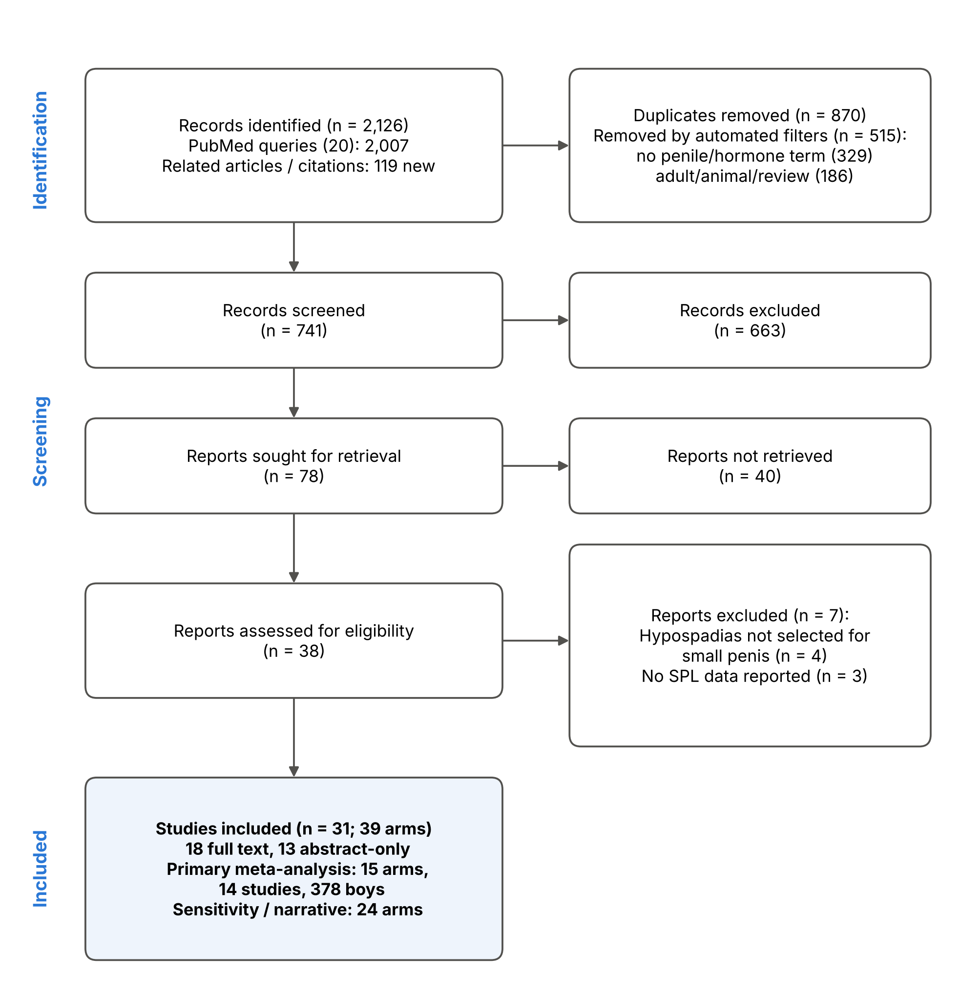
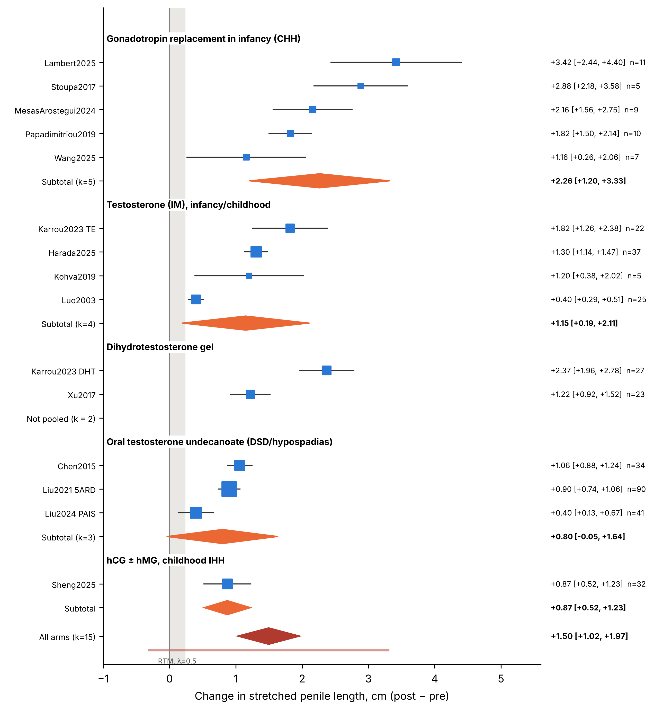

> **Note to authors — complete before submission**
>
> 1. **Screening and extraction.** These were performed with an AI-assisted workflow using PubMed only, with a single extractor. Every value is stored with its verbatim source in `data/arm_extraction.csv` and `data/ipd_extraction.csv`, and the curation decisions are coded in `code/analysis.py`. Two independent reviewers must repeat screening and extraction, and complete the ROBINS-I and JBI appraisals.
> 2. **Search.** Extend the search to Embase, Scopus and CNKI. Obtain the PDFs for:
>    - Avril 2023, Table 1 and Supplementary Table 2;
>    - Chen 2015, the control-group SPL;
>    - "Roddick et al.", cited in a 2026 review but not found in PubMed.
> 3. **Possible duplicate publication.** Two reports [1,2] contain closely similar methods text and identical testicular-volume results. Verify this before discussing it in print. Neither report contributes to the primary analysis.
> 4. **Registration and disclosure.** Register the review in PROSPERO, or declare it unregistered, and disclose AI assistance.

# Hormonal treatment of micropenis in infancy and childhood: a systematic review and meta-analysis of change in stretched penile length, benchmarked against regression to the mean

**Authors:** [Author 1]^1^, … [Senior author]^1^

^1^ [Department of Pediatric Endocrinology, Institution, City, Country]

**Correspondence:** [name, e-mail]

**Word count:** ~5,000; **Tables:** 3; **Figures:** 2

---

## Abstract

**Background.** Micropenis is treated with gonadotropins or androgens on the strength of uncontrolled case series. Such series are vulnerable to regression to the mean, because patients are selected on a single low measurement, and to physiological growth during treatment. No previous synthesis has quantified the treatment response across therapeutic classes or benchmarked it against these biases.

**Methods.** We searched PubMed from inception to 18 November 2026 for studies with at least three boys aged 0–18 years with micropenis or small penis, treated hormonally, with stretched penile length (SPL) reported before and after treatment. Methods were as follows:

- **Curation.** Inclusion rules were pre-specified for overlapping cohorts, outcome type and population. Medians were converted to means only when an IQR or range was given.
- **Change SD.** The SD of the change was taken as reported, or computed from individual patient data (IPD), or derived using the pre–post correlation observed in the IPD.
- **Pooling.** Within-arm changes were pooled by random effects (REML; Hartung–Knapp CIs), with subgroup analyses by therapeutic group.
- **Benchmarking.** Effects were compared with the regression to the mean expected from a companion simulation.

**Results.** Thirty-one studies (39 arms) were included. Fifteen arms from 14 studies (378 boys) entered the primary analysis.

- **Overall.** SPL increased by 1.50 cm (95% CI 1.02–1.97). Heterogeneity was substantial (τ = 0.81 cm; 95% prediction interval −0.31 to 3.30).
- **By therapeutic group:**
  - gonadotropin replacement in infants with congenital hypogonadotropic hypogonadism: +2.26 cm (1.20–3.33; k = 5), a median doubling of SPL;
  - intramuscular testosterone in infancy or childhood: +1.15 cm (0.19–2.11; k = 4);
  - oral testosterone undecanoate in differences of sex development or hypospadias: +0.80 cm (−0.05 to 1.64; k = 3).
- **Meta-regression.** Compared with infant gonadotropin therapy, effects were smaller with IM testosterone (−1.10 cm; p = 0.039) and with oral testosterone undecanoate (−1.47 cm; p = 0.014).
- **The only randomised comparison.** DHT gel exceeded testosterone enanthate by 0.55 cm (−0.11 to 1.21).
- **Durability.** Gains after infant gonadotropin infusion persisted into early adolescence.
- **Regression to the mean.** At realistic measurement error, expected regression to the mean is 0.1–0.6 cm. It could account for the smallest reported effects but not for most.
- **Controlled evidence.** No study reported SPL change in a concurrent untreated group.

Certainty was low to very low.

**Conclusions.** Hormonal treatment increases SPL, and the gain is largest when gonadotropins are given to infants with congenital hypogonadotropic hypogonadism during the minipubertal window. The evidence base is nonetheless almost entirely uncontrolled. Future trials need concurrent controls, blinded duplicate measurement, and baselines obtained independently of the measurement used for selection.

**Keywords:** micropenis; congenital hypogonadotropic hypogonadism; minipuberty; gonadotropins; testosterone; dihydrotestosterone; meta-analysis; regression to the mean

---

## 1. Introduction

Micropenis, a stretched penile length (SPL) more than 2.5 SD below the mean for age [3,4], is a sign rather than a diagnosis. Its causes include:

- congenital hypogonadotropic hypogonadism (CHH), isolated or within combined pituitary hormone deficiency;
- partial androgen insensitivity;
- defects of androgen synthesis or 5α-reduction;
- a large idiopathic group [5–7].

Whatever the cause, treatment aims to increase penile size during childhood to a range compatible with normal appearance, and, in the longer term, with urinary and sexual function and psychosexual wellbeing.

Three strategies are in clinical use.

1. **Short courses of androgen.** The longest-established is intramuscular testosterone esters, typically 25–50 mg monthly for three months. Topical testosterone and dihydrotestosterone (DHT) gels are alternatives, the latter particularly where 5α-reductase activity is deficient or androgen sensitivity partial [4,7].
2. **Gonadotropin replacement during minipuberty in CHH.** Recombinant LH and FSH, or hCG with FSH, given during the window of physiological postnatal axis activation, aim to reproduce minipuberty. They seek to induce penile growth and testicular descent and to promote Sertoli-cell proliferation [8–11].
3. **Expectant management**, which is rarely formally compared.

The evidence for each strategy rests almost entirely on uncontrolled case series. Outcomes are measured by unblinded investigators who selected the boys because a measurement fell below a threshold. Under these conditions, three sources of apparent improvement are inseparable from a true treatment effect without a control group:

- physiological growth;
- regression to the mean;
- measurement drift.

Our companion simulation (Paper 4 of this series) quantified one of them. Among boys selected on a single measurement, untreated re-measurement by an independent examiner yields an apparent gain of 0.17–0.58 SD at realistic levels of measurement error, or 0.7–2.3 mm in a newborn.

A recent PROSPERO-registered systematic review synthesised 11 studies of gonadotropin therapy in 71 infants with CHH. It combined treatment modalities and reported a significant increase in penile length [12]. A narrative review of 12 studies reached similar conclusions [13]. Neither, however, compared gonadotropins with the androgen therapies used far more widely, quantified heterogeneity, or placed the observed changes against the sources of non-treatment change described above. We undertook a systematic review and meta-analysis of hormonal treatment of micropenis in infants, children and adolescents, with four aims:

1. to estimate the mean change in SPL with each class of intervention;
2. to explore heterogeneity by age at treatment and by diagnosis;
3. to summarise adverse effects;
4. to appraise the magnitude of treatment effects relative to the expected contribution of regression to the mean and physiological growth.

## 2. Methods

The review is reported according to PRISMA 2020 [14].

### 2.1 Eligibility

**Population.** Boys aged 0–18 years with micropenis or a small penis, of any aetiology.

**Interventions.**

- intramuscular testosterone;
- topical testosterone;
- DHT;
- hCG, with or without FSH;
- recombinant gonadotropins, including subcutaneous infusion during minipuberty;
- pulsatile GnRH;
- other hormonal agents used to promote penile growth.

**Comparators.** None required. Controlled studies were analysed by arm.

**Outcome.** SPL before and after treatment.

**Designs.** Randomised trials, prospective or retrospective cohorts, and case series with at least three patients. Single case reports were excluded unless they formed part of a published individual-patient-data (IPD) table.

### 2.2 Search, selection and extraction

PubMed was searched from inception to 18 November 2026; the strategy and hit counts are given in Supplementary File S1. For every treatment arm we extracted:

- design and diagnosis;
- age at start;
- regimen and follow-up;
- n;
- SPL before and after treatment (mean ± SD, or median and range), with the change and its SD when reported;
- SPL SDS when reported;
- adverse events.

Where full texts tabulated values for individual patients, the IPD were extracted separately. Every number was stored with its verbatim source.

### 2.3 Statistical analysis

**Effect measure.** The effect was the mean within-arm change in SPL, in cm. Its variance was SD~change~²/n. The SD of the change was taken in the following order of preference:

1. as reported;
2. computed from IPD when available for the arm;
3. derived from the pre- and post-treatment SDs and a pre–post correlation r [15].

The value of r was estimated as the median of the study-level correlations in the IPD pool, with sensitivity analyses at r = 0.3, 0.5, 0.7 and 0.9. Medians and ranges were converted to means and SDs [16,17].

**Pooling.** Changes were pooled by random-effects meta-analysis, with REML τ² and Hartung–Knapp–Sidik–Jonkman confidence intervals [18], overall and by intervention class. 95% prediction intervals were also reported [19].

**Heterogeneity.** Heterogeneity was explored by mixed-effects meta-regression on three covariates:

- age at treatment: infancy (≤24 months) vs later;
- diagnosis: CHH vs other;
- intervention class.

**Small-study effects.** Egger's test was applied when at least 10 arms were available [20].

**SDS analysis.** Where SPL SDS was reported before and after treatment, the change in SDS was pooled separately. This analysis partly accounts for growth expected with age.

**Benchmarking against non-treatment sources of change.**

- *Regression to the mean.* Pooled changes were compared with the expected regression to the mean derived in Paper 4. That simulation gives 0.17, 0.58 and 1.07 SD at measurement-error ratios λ = 0.25, 0.5 and 0.75.
- *Physiological growth.* Pooled changes were also compared with physiological penile growth in infancy, about 1 mm per month from birth to 3 months in healthy boys [21].

### 2.4 Risk of bias and certainty

**Risk of bias.**

- Non-randomised arms were appraised with the JBI checklist for case series [22].
- Comparative non-randomised studies were appraised with ROBINS-I [23].
- Particular attention was given to selection on a single measurement, blinding of outcome measurement, and the number of baseline measurements.

**Certainty.** Certainty was rated with GRADE [24].

### 2.5 Pre-specified curation rules

Curation followed four rules, coded line by line in the analysis script.

**R1 — overlapping cohorts.** Where reports from the same centre overlapped, the larger cohort was retained. The excluded report was used in a swap sensitivity analysis. This applied to three programmes:

- the Paris gonadotropin-pump programme: Lambert 2025 retained, Lambert 2016 not used [11,25];
- Beijing, 5α-reductase deficiency: Liu 2021 retained, Wen 2023 swapped [26,27];
- Beijing, partial androgen insensitivity: Liu 2024 retained, Wen 2026 swapped [28,29].

**R2 — excluded from the primary analysis.** The following arms were excluded:

- arms measuring erect rather than stretched length [30];
- arms with unpaired pre- and post-treatment subsets [31];
- cohorts composed mainly of adults [2];
- pubertal induction in anorchia, which is a different clinical construct [32];
- arms without a sample size.

**R3 — conversion of medians.** Medians were converted to means and SDs only when an IQR or range was reported.

**R4 — SD of the change.** The SD of the change was taken in this order of preference: as reported; from IPD; or derived with r equal to the median pre–post correlation in the IPD. That median was r = 0.29, the mean of the two available studies (r = −0.06 and r = 0.64).

## 3. Results

### 3.1 Study selection

PubMed queries returned 2,007 records. Related-article and citation searches added 195, of which 119 were new.

- **Before screening.** We removed 870 duplicates and 515 records by automated filters (no penile-size and hormone term; adult-only, animal-only or review).
- **Screening.** 741 records were screened.
- **Retrieval.** 78 reports were sought. Fifty-three had no full text in PubMed Central: 13 of these were included on the strength of their abstracts, and 40 could not be assessed.
- **Eligibility.** Of 25 full texts assessed, 7 were excluded. Four were hypospadias studies not selected for small penis; their reasons are listed in Supplementary Table S2.

Thirty-one studies were included: 18 assessed in full text and 13 from abstracts. They contained 39 treatment arms and 51 rows of individual patient data. Fifteen arms from 14 studies, comprising 378 boys, met the criteria for the primary analysis (Table 1).

**Figure 1.** PRISMA 2020 flow diagram.

### 3.2 Characteristics of the primary arms

The 15 primary arms fell into five therapeutic groups (Table 1):

- **Gonadotropin replacement in infancy for CHH** (5 arms, 42 infants). Treatment started at a median age of 1.5–6.4 months. Regimens were continuous subcutaneous recombinant LH and FSH, hCG with recombinant FSH, or a pulsatile GnRH pump.
- **Intramuscular testosterone enanthate** (4 arms, 89 boys), aged 2.5 months to about 10 years.
- **DHT gel** (2 arms, 50 boys).
- **Oral testosterone undecanoate** in 5α-reductase deficiency, partial androgen insensitivity or microphallic hypospadias (3 arms, 165 boys).
- **hCG with or without hMG** in childhood idiopathic hypogonadotropic hypogonadism (1 arm, 32 boys), followed for a mean of 2.75 years.

**Design.** Only one study randomised patients between active treatments: DHT gel vs testosterone enanthate in idiopathic micropenis [33]. One allocated untreated controls but did not report their SPL [34]. All other arms were single-group before–after series.

**Table 1. Treatment arms in the primary analysis.**

| Arm | Diagnosis | Age at start | Regimen (summary) | n | Pre (cm) | Post (cm) | Change (cm) | SD of change, source |
|---|---|---|---|---|---|---|---|---|
| Lambert 2025 [25] | CHH | median 4.5 mo | CSC rhLH + rhFSH, ~6 mo | 11 | 1.72 | 5.14 | +3.42 | 1.46, IPD |
| Stoupa 2017 [10] | CHH | early infancy | CSC recombinant gonadotropins | 5 | 1.38 | 4.26 | +2.88 | 0.57, derived |
| Mesas-Aróstegui 2024 [35] | CHH | median 1.5 mo | hCG + rFSH-α | 9 | 2.17ᵃ | 4.33ᵃ | +2.16 | 0.77, derived |
| Papadimitriou 2019 [9] | CHH, bilateral cryptorchidism | median 4.2 mo | SC rhLH + rhFSH daily × 3 mo | 10 | 2.00ᵃ | 3.82ᵃ | +1.82 | 0.45, derived |
| Wang 2025 [36]ᶠ | CHH | 6.4 ± 4.4 mo | pulsatile GnRH pump, 3–5 mo | 7 | 1.27 | 2.43 | +1.16 | 0.97, derived |
| Karrou 2023, TE [33] | idiopathic micropenis (RCT) | 10 ± 3.4 y | TE 50 mg monthly × ~2.6 | 22 | 3.0 | 4.8 | +1.82 | 1.27, derived |
| Harada 2025 [37] | micropenis | median 9 mo | TE 25 mg monthly × 3 | 37 | 2.2ᵇ | 3.5ᵇ | +1.30 | 0.50, from IQR of change |
| Kohva 2019 [38] | CHH or CPHD | 2.5 ± 1.3 mo | rFSH + IM testosterone | 5 | 1.7 | 2.9 | +1.20 | 0.66, derived |
| Luo 2003 [39] | microphallic hypospadias | 6–18 mo | TE 25 mg monthly × 3 | 25 | 1.98 | 2.38 | +0.40 | 0.26, derived |
| Karrou 2023, DHT [33] | idiopathic micropenis (RCT) | 8.4 ± 3.7 y | DHT gel 5 mg/d, ~65 d | 27 | 2.9 | 5.3 | +2.37 | 1.04, derived |
| Xu 2017 [40] | micropenis, unknown cause | 4.1 ± 3.4 y | DHT 2.5% gel, 6 mo | 23 | 1.68 | 2.90 | +1.22 | 0.68, derived |
| Liu 2021 [26] | 5α-reductase deficiency | median 1.7 y | oral TU 2–3 mg/kg/d × 3 mo | 90 | 1.9 | 2.8 | +0.90 | 0.78, derived |
| Liu 2024 [28] | PAIS | childhood | oral TU, first course | 41 | 2.3 | 2.7 | +0.40 | 0.85, derived |
| Chen 2015 [34] | microphallic hypospadias | NR | oral TU, pre-operative | 34 | — | — | +1.06 | 0.53, reported |
| Sheng 2025 [41]ᶠ | IHH | childhood | hCG ± hMG courses; ~2.75 y follow-up | 32 | 2.48 | 3.35 | +0.87 | 0.98, IPD |

Notes to Table 1:

- ᵃ Mean estimated from the median with IQR or range.
- ᵇ Median.
- ᶠ Flagged:
  - Wang 2025: stretch not stated;
  - Sheng 2025: long follow-up, so physiological growth is included in the change.
- Abbreviations: CSC, continuous subcutaneous; TE, testosterone enanthate; TU, testosterone undecanoate; NR, not reported.

### 3.3 Pooled change in SPL

**Overall.** Across all 15 arms, SPL increased by **1.50 cm** (95% CI 1.02–1.97; Figure 2). Heterogeneity was substantial (τ = 0.81 cm; I² = 96%), and the 95% prediction interval for the change in a new arm was −0.31 to 3.30 cm. The median proportional increase was 72%.

**By therapeutic group** (Table 2):

- **Infant gonadotropin replacement for CHH** produced the largest gain: +2.26 cm (1.20–3.33; k = 5; n = 42). This represents a median doubling of SPL (proportional increase 100%).
- **IM testosterone** produced +1.15 cm (0.19–2.11; k = 4; n = 89), a 60% increase.
- **DHT gel** produced +2.37 cm and +1.22 cm in its two arms; these were not pooled.
- **Oral testosterone undecanoate** produced +0.80 cm (−0.05 to 1.64; k = 3; n = 165), a 32% increase.
- **hCG with or without hMG in childhood IHH** produced +0.87 cm (0.52–1.23) over a mean follow-up of 2.75 years.

**Meta-regression.** Therapeutic group explained 41% of between-arm variance. Taking infant gonadotropin replacement as the reference, the gain was smaller with:

- IM testosterone: −1.10 cm (−2.13 to −0.07; p = 0.039);
- oral testosterone undecanoate: −1.47 cm (−2.56 to −0.37; p = 0.014);
- hCG with or without hMG: −1.38 cm (−3.03 to 0.26; p = 0.09);
- DHT: −0.47 cm (−1.74 to 0.79; p = 0.42).

**Randomised comparison.** In the single randomised comparison, the gain with DHT gel exceeded that with testosterone enanthate by 0.55 cm (−0.11 to 1.21; p = 0.10) [33]. Both arms reached a mean SPL SDS of about −0.7.

**Table 2. Pooled change in SPL by therapeutic group.**

| Group | k | n | Pooled change, cm (95% CI) | 95% PI | Median % increase |
|---|---|---|---|---|---|
| Gonadotropin replacement in infancy (CHH) | 5 | 42 | +2.26 (1.20 to 3.33) | −0.48 to 5.01 | 100 |
| IM testosterone, infancy/childhood | 4 | 89 | +1.15 (0.19 to 2.11) | −1.64 to 3.94 | 60 |
| DHT gel | 2 | 50 | not pooled (+2.37; +1.22) | — | 78 |
| Oral testosterone undecanoate | 3 | 165 | +0.80 (−0.05 to 1.64) | −3.95 to 5.54 | 32 |
| hCG ± hMG, childhood IHH | 1 | 32 | +0.87 (0.52 to 1.23) | — | 35 |
| **All arms** | **15** | **378** | **+1.50 (1.02 to 1.97)** | **−0.31 to 3.30** | **72** |

**Figure 2.** Forest plot of within-arm change in SPL, grouped by therapy. Squares show arm estimates with 95% CIs; orange diamonds show subgroup pooled estimates; the red diamond shows the overall pooled estimate, with its 95% prediction interval beneath. The grey band marks the regression to the mean expected after selection on a single measurement at λ = 0.5 in a newborn (0.23 cm; Paper 4).

### 3.4 Durability

In the Paris infusion cohort, SPL in early adolescence (median age 12.9 years) had a median of 5.0 cm (range 4.0–7.0). The authors described this as not significantly different from the length at the end of infusion [25]. The gain achieved in infancy was therefore retained, without catch-down, until puberty.

No other study reported prepubertal follow-up of SPL beyond 1 year after treatment.

### 3.5 Arms not in the primary analysis

Arms not pooled were broadly concordant with the primary results.

**Childhood androgen series:**

- In 53 boys given 1–4 injections of testosterone enanthate, median SPL rose from 2.5 to 3.5 cm, and median SDS from −2.6 to −0.7 [42].
- SDS gains of +2.1 ± 0.8 were reported in isolated micropenis and +1.3 ± 1.2 in micropenis with hypospadias [43].
- A gain of +1.9 ± 1.3 SDS was reported in anorchia [44].
- Selected poor responders improved by a median of only +0.6 SDS [45].

**DHT:**

- 5α-reductase deficiency: median SPL rose from 2.6 to 4.4 cm in four boys [46].
- Micropenis: gains of 0.5–2.0 cm were reported in six boys [47].

**Gonadotropins.** In a multicentre comparison of infants with CHH, penile growth was faster with gonadotropin injections than with pump infusion: +0.16 vs +0.10 mm per day (p = 0.002) [48].

**Adolescents** (excluded under R2):

- Erect length increased by 2.2 ± 1.6 cm with hCG/hMG and by 1.0 ± 0.8 cm with a GnRH pump [30].
- Two further series reported gains of 2–3 cm with hCG or testosterone [2,31].

### 3.6 Sensitivity analyses and small-study effects

The pooled estimate was insensitive to the assumed pre–post correlation, at 1.50 cm for every r from 0.3 to 0.9. Between-arm heterogeneity, not within-arm sampling error, dominates its uncertainty.

The estimate was also robust to the following analyses:

| Analysis | Pooled change, cm (95% CI) | k |
|---|---|---|
| Swapping overlapping cohorts | +1.55 (1.11–2.00) | 15 |
| Restriction to full-text arms | +1.66 (1.12–2.20) | 10 |
| Excluding median-converted arms | +1.44 (0.84–2.03) | 12 |
| Excluding the two flagged arms | +1.57 (1.03–2.11) | 13 |

**Small-study effects.** Egger's test indicated small-study effects (intercept 6.6; p = 0.003). The pattern is confounded by therapeutic group: the infant gonadotropin series are both the smallest (n = 5–11) and the most effective. Selective publication of favourable small series cannot, however, be excluded.

### 3.7 Benchmarking against regression to the mean

In our companion simulation, boys selected on a single measurement and then re-measured independently showed an apparent gain of:

- 0.17 SD at measurement error λ = 0.25;
- 0.58 SD at λ = 0.5;
- 1.07 SD at λ = 0.75.

With an SPL SD of 0.4 cm in infancy and about 0.6 cm in childhood, this corresponds to 0.07–0.43 cm and 0.10–0.64 cm respectively (Table 3).

**Comparison with treatment effects.**

- The pooled effects of infant gonadotropin therapy (+2.26 cm) and IM testosterone (+1.15 cm) exceed even the upper bound of expected regression to the mean.
- The smallest arm-level effects, +0.40 cm with testosterone in microphallic hypospadias [39] and with oral testosterone undecanoate in partial androgen insensitivity [28], lie within the range attributable to selection plus measurement error.

**Table 3. Expected regression to the mean after selection on a single measurement (Paper 4), in cm.**

| Measurement error λ | Infancy (SD 0.4 cm) | Childhood (SD 0.6 cm) |
|---|---|---|
| 0.25 | 0.07 | 0.10 |
| 0.50 | 0.23 | 0.35 |
| 0.75 | 0.43 | 0.64 |

### 3.8 Adverse effects

No serious adverse events were reported in any study, although systematic reporting of bone age and long-term outcomes was rare.

**Reported effects:**

- *Local reactions:* a site rash with a GnRH pump, which resolved after the site was moved [36].
- *Oral testosterone undecanoate:*
  - transient erectile pain in one boy;
  - advanced bone age in two boys who continued treatment without prescription for 3 months [26].
- *Topical testosterone:* supraphysiological testosterone with pubic hair in about 15% [49].
- *Hormone therapy in adolescents:* acne and frequent erections, which resolved with dose reduction [30].
- *DHT gel:* discontinuation by 13% of families because of anxiety about side effects [40].

Infant gonadotropin regimens were uniformly reported as well tolerated [9,11,35].

### 3.9 Risk of bias and certainty

All but one study were single-group before–after series. The one randomised trial compared two active treatments and did not describe its randomisation method [33]. No study reported:

- blinded outcome measurement;
- measurement by more than one examiner;
- a baseline obtained independently of the measurement used for selection.

Certainty of evidence was rated **low** for infant gonadotropin replacement, given the large effect, its consistency in direction, and a plausible dose–response with the minipubertal window. It was rated **very low** for all other groups, downgraded for risk of bias, inconsistency and imprecision.

---

## 4. Discussion

### 4.1 Principal findings

This is the first meta-analysis to compare the effect of the principal hormonal treatments for micropenis on SPL. It yields four findings.

1. **Treatment works.** Every therapeutic group increased SPL, by about 1.5 cm on average.
2. **Effects differ by group.** The largest and most consistent gains, a doubling of SPL, followed gonadotropin replacement in infants with CHH during the minipubertal window. These gains persisted to early adolescence in the one cohort followed that long.
3. **Androgens give moderate gains.** Androgen therapy in childhood produced gains of about 1 cm with IM testosterone and somewhat more with DHT gel. Oral testosterone undecanoate in DSD produced the smallest gains, under 1 cm.
4. **The evidence is almost entirely uncontrolled.** No study reported SPL in a concurrent untreated group.

### 4.2 Interpreting effects without controls

Without controls, two non-treatment sources of change must be accounted for.

**Regression to the mean.** Our simulation provides the first quantitative benchmark for it in this setting. Effects of 1–3 cm cannot be explained by it at realistic error levels. Effects of about 0.4 cm, as seen in some androgen series, can.

**Physiological growth.** This is the second source. In healthy boys, penile growth from birth to 3 months averages about 1 mm per month [21], so a 3-month course in infancy would include about 0.3 cm of expected growth.

Infants with CHH lack the minipubertal surge, so their untreated growth is presumably smaller. The large effects of gonadotropin replacement are therefore unlikely to be artefacts. The modest effects of androgen therapy in older children with partial androgen insensitivity, and of hCG over years of follow-up, are much harder to separate from growth and measurement.

### 4.3 The infant gonadotropin results

The infant gonadotropin results deserve emphasis. They agree with a recent systematic review that combined modalities [12], and they extend it in two ways.

1. **Size of the effect relative to androgens.** The pooled effect is about 1 cm larger than with IM testosterone given at a similar age.
2. **Durability.** In the one cohort with long follow-up, the gain was retained to early adolescence [25].

Whether the advantage over testosterone reflects the physiological, Sertoli-cell-supporting nature of gonadotropin replacement or simply greater total androgen exposure cannot be determined from these data. The comparison is also confounded by diagnosis: the gonadotropin arms were all CHH, whereas the testosterone arms were mixed.

### 4.4 DHT versus testosterone

The single randomised comparison suggests that DHT gel may produce gains at least as large as testosterone enanthate in idiopathic micropenis [33]. The difference was not significant, and the trial was small and incompletely reported.

DHT avoids aromatisation and acts directly on the androgen receptor at the target tissue. It is the logical choice in 5α-reductase deficiency [46]. Its wider use in idiopathic micropenis deserves a properly powered, blinded trial.

### 4.5 Implications for trial design

The most important implication concerns design rather than treatment choice. Future studies should:

1. **Use concurrent controls.** Randomise, where ethically acceptable, to immediate vs deferred treatment. The deferred arm then supplies a concurrent control at no long-term cost.
2. **Separate selection from baseline.** Obtain the baseline from a measurement independent of the one used for selection, and use the mean of two certified examiners.
3. **Blind outcome measurement.** Outcome assessors should be unaware of treatment status.
4. **Report outcomes in a poolable form.** Report SPL in cm and SDS against a technique-matched reference (Papers 1 and 5), together with the individual patient data or the pre–post correlation.

Of the 31 studies we identified, none met all four criteria.

### 4.6 Strengths and limitations

**Strengths.**

- The review covers all hormonal classes.
- Curation rules were explicit and coded.
- Individual patient data were used to estimate the pre–post correlation.
- Robustness was examined in multiple sensitivity analyses.
- This is the first quantitative benchmarking of treatment effects against regression to the mean.

**Limitations.**

- **Search and extraction.** The search was limited to PubMed, and extraction requires duplicate human verification.
- **Source of data.** Thirteen studies were available only as abstracts.
- **Pre–post correlation.** This rested on two IPD studies. The results, however, were insensitive to it.
- **Comparability of groups.** Groups differed in diagnosis, age and outcome timing, so between-group comparisons are observational.
- **Heterogeneity.** Some heterogeneity reflects differences in measurement technique, which we have shown elsewhere to be large (Paper 1).

### 4.7 Conclusion

Hormonal therapy increases penile length in boys with micropenis. The gain is largest, and probably durable, when gonadotropins are given to infants with CHH during the minipubertal window. The evidence base is nonetheless almost entirely uncontrolled, and its smallest reported effects are within the range of measurement artefact. The next generation of studies must be designed to tell the two apart.

---

## Declarations

**Funding:** [To be completed.]

**Competing interests:** [To be completed.]

**Data and code availability:** The following are provided as supplementary material:

- extraction files with verbatim sources;
- the curated arm table (`curated_arms.csv`);
- the analysis code;
- the full results (`results.json`).

**Author contributions:** [CRediT.]

---

## References

1. Nerli RB, Guntaka AK, Patne PB, Hiremath MB. Penile growth in response to hormone treatment in children with micropenis. Indian J Urol. 2013;29(4):288-91. doi:10.4103/0970-1591.120107 PMID: 24235789.
2. Kim SO, Ryu KH, Hwang IS, Jung SI, Oh KJ, Park K. Penile growth in response to human chorionic gonadotropin (HCG) treatment in patients with idiopathic hypogonadotrophic hypogonadism. Chonnam Med J. 2011;47(1):39-42. doi:10.4068/cmj.2011.47.1.39 PMID: 22111055.
3. Lee PA, Houk CP, Ahmed SF, Hughes IA. Consensus statement on management of intersex disorders. International Consensus Conference on Intersex. Pediatrics. 2006;118(2):e488-500. doi:10.1542/peds.2006-0738 PMID: 16882788.
4. Hatipoğlu N, Kurtoğlu S. Micropenis: etiology, diagnosis and treatment approaches. J Clin Res Pediatr Endocrinol. 2013;5(4):217-23. doi:10.4274/Jcrpe.1135 PMID: 24379029.
5. Boehm U, Bouloux PM, Dattani MT, de Roux N, Dodé C, Dunkel L, et al. Expert consensus document: European Consensus Statement on congenital hypogonadotropic hypogonadism--pathogenesis, diagnosis and treatment. Nat Rev Endocrinol. 2015;11(9):547-64. doi:10.1038/nrendo.2015.112 PMID: 26194704.
6. Ahmed SF, Achermann J, Alderson J, Crouch NS, Elford S, Hughes IA, et al. Society for Endocrinology UK Guidance on the initial evaluation of a suspected difference or disorder of sex development (Revised 2021). Clin Endocrinol (Oxf). 2021;95(6):818-840. doi:10.1111/cen.14528 PMID: 34031907.
7. Wiygul J, Palmer LS. Micropenis. ScientificWorldJournal. 2011;11:1462-9. doi:10.1100/tsw.2011.135 PMID: 21805015.
8. Bouvattier C, Maione L, Bouligand J, Dodé C, Guiochon-Mantel A, Young J. Neonatal gonadotropin therapy in male congenital hypogonadotropic hypogonadism. Nat Rev Endocrinol. 2011;8(3):172-82. doi:10.1038/nrendo.2011.164 PMID: 22009162.
9. Papadimitriou DT, Chrysis D, Nyktari G, Zoupanos G, Liakou E, Papadimitriou A, et al. Replacement of Male Mini-Puberty. J Endocr Soc. 2019;3(7):1275-1282. doi:10.1210/js.2019-00083 PMID: 31240270.
10. Stoupa A, Samara-Boustani D, Flechtner I, Pinto G, Jourdon I, González-Briceño L, et al. Efficacy and Safety of Continuous Subcutaneous Infusion of Recombinant Human Gonadotropins for Congenital Micropenis during Early Infancy. Horm Res Paediatr. 2017;87(2):103-110. doi:10.1159/000454861 PMID: 28081535.
11. Lambert AS, Bougneres P. Growth and descent of the testes in infants with hypogonadotropic hypogonadism receiving subcutaneous gonadotropin infusion. Int J Pediatr Endocrinol. 2016;2016:13. doi:10.1186/s13633-016-0031-9 PMID: 27379168.
12. Rhys-Evans S, d'Aniello F, Alexander EC, Dinah IF, Heger S, Nordenstrom A, et al. Gonadotropin Therapy for Mini-Puberty Induction in Male Infants With Hypogonadotropic Hypogonadism. J Clin Endocrinol Metab. 2025;110(4):e921-e931. doi:10.1210/clinem/dgae874 PMID: 39673783.
13. Cammisa I, Rigante D, Cipolla C. Gonadotropins in Mini-Puberty: Pathophysiological and Therapeutic Implications for Male Congenital Hypogonadism. Children (Basel). 2026;13(1):133. doi:10.3390/children13010133 PMID: 41597141.
14. Page MJ, McKenzie JE, Bossuyt PM, Boutron I, Hoffmann TC, Mulrow CD, et al. The PRISMA 2020 statement: an updated guideline for reporting systematic reviews. BMJ. 2021;372:n71. doi:10.1136/bmj.n71 PMID: 33782057.
15. Higgins JPT, Thomas J, Chandler J, Cumpston M, Li T, Page MJ, et al., editors. Cochrane Handbook for Systematic Reviews of Interventions. Version 6.5. Cochrane; 2024. Available from www.training.cochrane.org/handbook. †
16. Luo D, Wan X, Liu J, Tong T. Optimally estimating the sample mean from the sample size, median, mid-range, and/or mid-quartile range. Stat Methods Med Res. 2018;27(6):1785-1805. doi:10.1177/0962280216669183 PMID: 27683581.
17. Wan X, Wang W, Liu J, Tong T. Estimating the sample mean and standard deviation from the sample size, median, range and/or interquartile range. BMC Med Res Methodol. 2014;14:135. doi:10.1186/1471-2288-14-135 PMID: 25524443.
18. IntHout J, Ioannidis JP, Borm GF. The Hartung-Knapp-Sidik-Jonkman method for random effects meta-analysis is straightforward and considerably outperforms the standard DerSimonian-Laird method. BMC Med Res Methodol. 2014;14:25. doi:10.1186/1471-2288-14-25 PMID: 24548571.
19. Riley RD, Higgins JP, Deeks JJ. Interpretation of random effects meta-analyses. BMJ. 2011;342:d549. doi:10.1136/bmj.d549 PMID: 21310794.
20. Egger M, Davey Smith G, Schneider M, Minder C. Bias in meta-analysis detected by a simple, graphical test. BMJ. 1997;315(7109):629-34. doi:10.1136/bmj.315.7109.629 PMID: 9310563.
21. Boas M, Boisen KA, Virtanen HE, Kaleva M, Suomi AM, Schmidt IM, et al. Postnatal penile length and growth rate correlate to serum testosterone levels: a longitudinal study of 1962 normal boys. Eur J Endocrinol. 2006;154(1):125-9. doi:10.1530/eje.1.02066 PMID: 16382001.
22. Munn Z, Barker TH, Moola S, Tufanaru C, Stern C, McArthur A, et al. Methodological quality of case series studies: an introduction to the JBI critical appraisal tool. JBI Evid Synth. 2020;18(10):2127-2133. doi:10.11124/JBISRIR-D-19-00099 PMID: 33038125.
23. Sterne JA, Hernán MA, Reeves BC, Savović J, Berkman ND, Viswanathan M, et al. ROBINS-I: a tool for assessing risk of bias in non-randomised studies of interventions. BMJ. 2016;355:i4919. doi:10.1136/bmj.i4919 PMID: 27733354.
24. Guyatt GH, Oxman AD, Vist GE, Kunz R, Falck-Ytter Y, Alonso-Coello P, et al. GRADE: an emerging consensus on rating quality of evidence and strength of recommendations. BMJ. 2008;336(7650):924-6. doi:10.1136/bmj.39489.470347.AD PMID: 18436948.
25. Lambert AS, Trouvin MA, Fouatih K, Lecoeuvre A, Thomas-Teinturier C, Rothenbuhler A, et al. Early adolescence assessment of eleven boys treated with continuous subcutaneous infusion (CSGI) of recombinant LH and FSH during infancy. Endocr Connect. 2025;14(4). doi:10.1530/EC-24-0082 PMID: 40042209.
26. Liu Y, Fan L, Wang X, Gong C. Exploring the efficacy of testosterone undecanoate in male children with 5α-reductase deficiency. Pediatr Investig. 2021;5(4):249-254. doi:10.1002/ped4.12302 PMID: 34938965.
27. Wen X, Fan LJ, Zhang WP, Ni X, Gong CX. Genotype-phenotype correlations, surgical selections, and postoperative complications of 5α-reductase 2 deficiency in 69 children with hypospadias. Asian J Androl. 2023;25(6):731-736. doi:10.4103/aja202313 PMID: 37313883.
28. Liu Y, Li LL, Yuan Z, Wang XM, Wang XL, Fan LJ, et al. [Efficacy of oral testosterone undecanoate in children with androgen insensitivity syndrome]. Zhonghua Er Ke Za Zhi. 2024;62(8):758-763. Chinese. doi:10.3760/cma.j.cn112140-20240226-00122 PMID: 39039878.
29. Wen X, Fan LJ, Liu P, Shi JH, Zhang WP, Ni X, et al. Genetic variants, clinical characteristics, and surgical treatments of 46 children with androgen insensitivity syndrome. Asian J Androl. 2026;28(2):173-178. doi:10.4103/aja202546 PMID: 41504504.
30. Liu Y, Ren XY, Peng YG, Chen SK, Cheng XR, Qin M, et al. Efficacy and safety of human chorionic gonadotropin combined with human menopausal gonadotropin and a gonadotropin-releasing hormone pump for male adolescents with congenital hypogonadotropic hypogonadism. Chin Med J (Engl). 2021;134(10):1152-1159. doi:10.1097/CM9.0000000000001419 PMID: 33813517.
31. Agarwal S, Tu DD, Austin PF, Scheurer ME, Karaviti LP. Testosterone versus hCG in Hypogonadotropic Hypogonadism - Comparing Clinical Effects and Evaluating Current Practice. Glob Pediatr Health. 2020;7:2333794X20958980. doi:10.1177/2333794X20958980 PMID: 35187206.
32. Tack LJW, Brachet C, Beauloye V, Heinrichs C, Boros E, De Waele K, et al. Etiology, histology, and long-term outcome of bilateral testicular regression: a large Belgian series. Hum Reprod Open. 2023;2023(4):hoad047. doi:10.1093/hropen/hoad047 PMID: 39659563.
33. Karrou M, Messaoudi N, Assarrar I, Alla A, Rouf S, Latrech H. Efficacy of Transdermal Dihydrotestosterone and Testosterone Enanthate for Penile Augmentation in Patients With Idiopathic Micropenis: A Comparative Randomized Study. Clin Med Insights Endocrinol Diabetes. 2023;16:11795514231208328. doi:10.1177/11795514231208328 PMID: 37920173.
34. Chen C, Gong CX, Zhang WP. Effects of oral testosterone undecanoate treatment for severe hypospadias. Int Urol Nephrol. 2015;47(6):875-80. doi:10.1007/s11255-015-0972-6 PMID: 25894960.
35. Mesas-Aróstegui MA, Hita-Contreras F, López-Siguero JP. A Therapeutic Proposal for Mini-Puberty in Male Infants with Hypogonadotropic Hypogonadism: A Retrospective Case Series. J Clin Med. 2024;13(22). doi:10.3390/jcm13226983 PMID: 39598127.
36. Wang X, Zhang ZX, Chen J, Fu D, Du M, Chen Y, et al. Efficacy and safety of pulsatile GnRH pump therapy in male infants with congenital hypogonadotropic hypogonadism. Endocr Connect. 2025;14(5). doi:10.1530/EC-24-0655 PMID: 40099791.
37. Harada J, Mitsunari K, Kakita S, Fukushima H, Kawamura H, Kurata H, et al. Clinical Predictors of Response to Testosterone Replacement Therapy in Boys With Micropenis: A Retrospective Study Focusing on Penile Morphology and Hormonal Factors. Int J Urol. 2025;32(11):1670-1676. doi:10.1111/iju.70204 PMID: 40813749.
38. Kohva E, Huopio H, Hietamäki J, Hero M, Miettinen PJ, Raivio T. Treatment of gonadotropin deficiency during the first year of life: long-term observation and outcome in five boys. Hum Reprod. 2019;34(5):863-871. doi:10.1093/humrep/dez040 PMID: 31067328.
39. Luo CC, Lin JN, Chiu CH, Lo FS. Use of parenteral testosterone prior to hypospadias surgery. Pediatr Surg Int. 2003;19(1-2):82-4. doi:10.1007/s00383-002-0717-3 PMID: 12721732.
40. Xu D, Lu L, Xi L, Cheng R, Pei Z, Bi Y, et al. Efficacy and safety of percutaneous administration of dihydrotestosterone in children of different genetic backgrounds with micropenis. J Pediatr Endocrinol Metab. 2017;30(12):1285-1291. doi:10.1515/jpem-2016-0400 PMID: 29176021.
41. Sheng H, Liang C, Cheng J, Liu H, Mao X, Li X, et al. Clinical characteristics, genetic spectrum and therapeutic effects of 51 male patients with idiopathic hypogonadotropic hypogonadism from southern China. Orphanet J Rare Dis. 2025;20(1):574. doi:10.1186/s13023-025-04050-2 PMID: 41225491.
42. Ishii T, Sasaki G, Hasegawa T, Sato S, Matsuo N, Ogata T. Testosterone enanthate therapy is effective and independent of SRD5A2 and AR gene polymorphisms in boys with micropenis. J Urol. 2004;172(1):319-24. doi:10.1097/01.ju.0000129005.84831.1e PMID: 15201804.
43. Velásquez-Urzola A, Léger J, Aigrain Y, Czernichow P. [Hypoplasia of the penis: etiologic diagnosis and results of treatment with delayed-action testosterone]. Arch Pediatr. 1998;5(8):844-50. French. doi:10.1016/s0929-693x(98)80123-1 PMID: 9759289.
44. Zenaty D, Dijoud F, Morel Y, Cabrol S, Mouriquand P, Nicolino M, et al. Bilateral anorchia in infancy: occurence of micropenis and the effect of testosterone treatment. J Pediatr. 2006;149(5):687-91. doi:10.1016/j.jpeds.2006.07.044 PMID: 17095345.
45. Husmann DA. The androgen insensitive micropenis: long-term follow-up into adulthood. J Pediatr Endocrinol Metab. 2004;17(8):1037-41. doi:10.1515/jpem.2004.17.8.1037 PMID: 15379413.
46. Sasaki G, Ishii T, Hori N, Amano N, Homma K, Sato S, et al. Effects of pre- and post-pubertal dihydrotestosterone treatment on penile length in 5α-reductase type 2 deficiency. Endocr J. 2019;66(9):837-842. doi:10.1507/endocrj.EJ19-0111 PMID: 31178538.
47. Charmandari E, Dattani MT, Perry LA, Hindmarsh PC, Brook CG. Kinetics and effect of percutaneous administration of dihydrotestosterone in children. Horm Res. 2001;56(5-6):177-81. doi:10.1159/000048115 PMID: 11910204.
48. Avril T, Hennocq Q, Lambert AS, Leger J, Simon D, Martinerie L, et al. Gonadotropin administration to mimic mini-puberty in hypogonadotropic males: pump or injections? Endocr Connect. 2023;12(4). doi:10.1530/EC-22-0252 PMID: 36724045.
49. Chalapathi G, Rao KL, Chowdhary SK, Narasimhan KL, Samujh R, Mahajan JK. Testosterone therapy in microphallic hypospadias: topical or parenteral? J Pediatr Surg. 2003;38(2):221-3. doi:10.1053/jpsu.2003.50047 PMID: 12596107.
