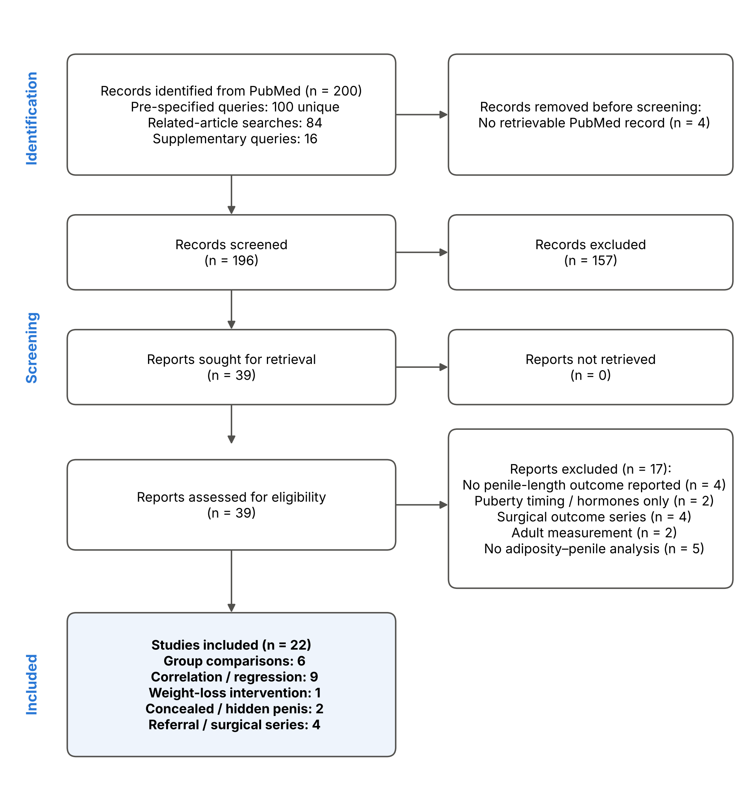
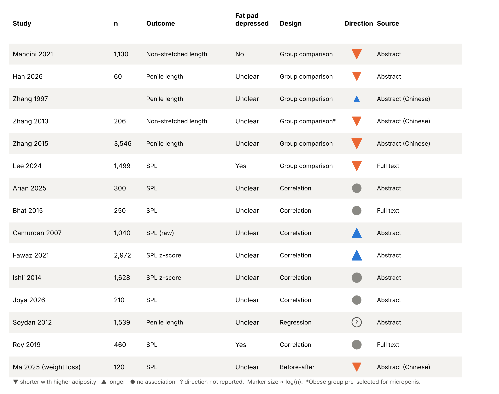

> **Note to authors — complete before submission**
>
> 1. **Screening and extraction.** These were performed with an AI-assisted literature workflow (PubMed only). Every extracted value is stored with its verbatim source sentence in `data/obesity_extraction.csv`. Two independent reviewers must re-screen and verify extraction, and the Methods must then be revised to describe what was actually done.
> 2. **Extend the search** to Embase, Scopus, Web of Science and CNKI/Wanfang. Four included studies are Chinese-language and were assessed from English abstracts only.
> 3. **Registration.** PROSPERO registration was not obtained in advance. Either register before the updated search and state this, or declare the review unregistered.
> 4. **Disclose AI assistance** as required by the target journal.

# Obesity and the apparent micropenis: a systematic review of adiposity, measurement technique and penile length in children and adolescents

**Authors:** [Author 1]^1^, … [Senior author]^1^

^1^ [Department of Pediatric Endocrinology, Institution, City, Country]

**Correspondence:** [name, e-mail]

**Word count:** ~4,300; **Tables:** 3; **Figures:** 2

---

## Abstract

**Background.** Boys with obesity are frequently referred for "small penis". The suprapubic fat pad can conceal the penile shaft, but obesity is also associated with lower testosterone. Whether adiposity reduces true penile size or only its measured length is unresolved, and the answer matters for diagnosis.

**Objective.** To synthesise the evidence on adiposity and penile length in boys aged 0–18 years. We gave particular attention to whether the observed association depends on measurement technique, specifically on depression of the suprapubic fat pad.

**Methods.** We searched PubMed from inception to 18 November 2026. Eligible studies were primary studies reporting penile length by adiposity category, the association of penile length with BMI or waist circumference, the prevalence of apparent micropenis or buried penis attributable to obesity, or the effect of weight loss on penile length. Heterogeneity of outcomes, techniques and effect measures precluded meta-analysis of the main question. We therefore followed the SWiM reporting guideline: we used vote counting by direction of effect, presented in an effect-direction plot stratified by technique, and calculated exact confidence intervals for quantifiable comparisons. Certainty was rated with GRADE.

**Results.** Twenty-two studies (≥15,768 children) were included.

- *Group comparisons.* Five of six reported shorter penile length in boys with obesity. Only one used stretched penile length (SPL) with explicit fat-pad depression; in it the difference was trivial: −0.18 cm (95% CI −0.34 to −0.02; standardised mean difference −0.11; n = 1,499). The largest deficits were reported for non-stretched length or with undescribed technique.
- *Correlation studies.* None of nine reported a negative association between SPL and BMI. Five found no association, two a positive one, and two did not report or could not interpret direction.
- *Weight loss.* In a 30-day trial, SPL rose by 0.37 cm with nutritional weight loss alone, a gain too rapid to represent growth.
- *Referral series.* Three series found that 19%, 31% and 43% of boys referred for micropenis did not have it, with obesity-related buried penis a leading cause (exploratory pooled estimate 30%, 95% CI 9–65%).

The certainty of evidence was very low for every outcome.

**Conclusions.** The available evidence is more consistent with obesity reducing measured than true penile length. When the fat pad is fully depressed, the difference largely disappears. Obesity-related "micropenis" is a common, avoidable referral error. A possible true androgen-mediated effect in pubertal boys cannot be excluded. Measurement with and without fat-pad depression should be standard in children with obesity, and in weight-loss trials, including pharmacotherapy trials in adolescents.

**Keywords:** obesity; buried penis; concealed penis; micropenis; stretched penile length; suprapubic fat; children; adolescents; systematic review

**PROSPERO:** [see Note to authors]

---

## 1. Introduction

A boy with obesity whose penis appears small presents a recurring clinical dilemma. Two mechanisms can produce the appearance.

**The anatomical mechanism.** The suprapubic fat pad envelops the proximal shaft, so that the visible and the measured length both fall short of the true length unless the fat is fully displaced to the pubic symphysis. The resulting buried or concealed penis may also prompt surgical referral [@Casale1999].

**The endocrine mechanism.** Obesity in adolescent boys is associated with lower circulating testosterone [@Mogri2013]. Penile growth is androgen-dependent [@Boas2006], so obesity could in principle reduce true penile size, particularly during puberty.

The two mechanisms imply different management. If the deficit is anatomical, the correct response is accurate measurement and reassurance, with weight management on its own merits. If it is endocrine, it may warrant evaluation of the hypothalamic–pituitary–gonadal axis.

The diagnostic stakes are not trivial. Micropenis is defined as SPL below −2.5 SD [@Lee2006; @Hatipoglu2013]. In a companion simulation study (Paper 4 of this series), a systematic under-measurement of 0.5 SD inflated the apparent prevalence of micropenis about four-fold. At a bias of that size, a positive measurement was more likely to be wrong than right.

No systematic review has addressed the relation between adiposity and penile length in children. We therefore asked four questions:

1. Do boys with higher adiposity have shorter measured penile length?
2. Does the association depend on whether the suprapubic fat pad is depressed?
3. How often is obesity responsible for an erroneous referral for micropenis?
4. Does weight loss change measured penile length?

---

## 2. Methods

The review is reported in accordance with PRISMA 2020 [@Page2021] and the Synthesis Without Meta-analysis (SWiM) guideline [@Campbell2020].

### 2.1 Eligibility criteria

**Population.** Boys aged 0–18 years.

**Exposure.** Adiposity, defined by BMI category (percentile or SDS references, e.g. WHO or IOTF [@deOnis2007; @Cole2000]), BMI, waist circumference, or clinical obesity.

**Outcomes.**

- *Primary:* penile length (stretched, non-stretched or "natural"), as a group comparison or as an association with adiposity.
- *Secondary:* the proportion of boys referred for micropenis in whom obesity-related buried penis, or normal SPL, was found; the association of concealed or buried penis with adiposity; and change in penile length with weight loss.

**Designs.** Cross-sectional, cohort, case–control, intervention and referral-series studies. Case reports, adult studies and studies of syndromic obesity were excluded.

### 2.2 Search

PubMed was searched on 18 November 2026, with no date or language restriction. Eight pre-specified queries were combined with seven supplementary queries and with forward and backward related-article searches from three seed studies (Supplementary Table S1). The full queries and hit counts are given in the search log.

### 2.3 Selection and data extraction

Records were screened on title and abstract, and the full text was obtained from PubMed Central where available. The following were extracted:

- design, country and age range;
- adiposity definition and measurement technique, with explicit attention to fat-pad depression and to whether the penis was stretched;
- group sizes, means and SDs;
- correlation or regression coefficients;
- counts for referral series.

Every extracted value was stored with the verbatim sentence or table cell from which it came. Values derived by calculation (for example, group size by subtraction, or percentages from counts) were flagged.

### 2.4 Synthesis

Outcomes were measured in different ways (stretched vs non-stretched), with different exposures (BMI category vs continuous indices), different effect measures (mean differences, correlations, regression coefficients without SEs, proportions) and largely unreported technique. Pooling of the primary question was therefore inappropriate.

Following SWiM, studies were grouped by design (group comparison; correlation or regression; before–after; referral series). Within each group, they were synthesised by vote counting based on the direction of effect, the method recommended when effect estimates cannot be combined [@Boon2021]. The results are displayed in an effect-direction plot [@Thomson2013], stratified by whether the fat pad was depressed.

Where means and SDs were available, we calculated mean differences with Welch 95% CIs and standardised mean differences. For within-arm change, the paired SD was not reported, so CIs were bounded under assumed pre–post correlations of 0.5 and 0.8.

For referral series, proportions were given Wilson 95% CIs. An exploratory pooled proportion was estimated on the logit scale with REML and the Hartung–Knapp adjustment [@IntHout2014]. It is reported with its 95% prediction interval, recognising that the definitions differ between series.

### 2.5 Assessment of methodological features and certainty

Because the designs were heterogeneous, we tabulated five methodological features most relevant to bias in this question instead of applying a single risk-of-bias tool:

1. measurement of stretched (not non-stretched) length;
2. explicit fat-pad depression;
3. a standardised adiposity definition;
4. adjustment for age, or use of age-standardised scores;
5. availability of a full report.

Certainty of evidence for each outcome was rated with GRADE [@Guyatt2008].

---

## 3. Results

### 3.1 Study selection and characteristics

Of 200 records identified, 4 had no retrievable PubMed record. The remaining 196 were screened. One hundred and fifty-seven were excluded on title and abstract, and 39 were assessed in depth. Of these, 17 were excluded (reasons in Supplementary Table S2), leaving 22 studies (Figure 1).

The included studies enrolled at least 15,768 children; one study did not report its sample size. They came from 12 countries:

- China (5);
- India (3);
- Turkey (3);
- South Korea (2);
- the USA (2);
- one each from Italy, Japan, Egypt, Qatar, Syria, Iran and Nigeria.

Only 7 full texts were available. Four studies were Chinese-language articles assessed from English abstracts. Table 1 summarises the methodological features.

**Figure 1.** PRISMA 2020 flow diagram. Records identified n = 200 (database queries 100; related articles 84; supplementary queries 16) → no record retrievable n = 4 → screened n = 196 → excluded n = 157 → assessed in depth n = 39 → excluded n = 17 → included n = 22.

**Table 1. Characteristics and methodological features of included studies.**

| Study | Country | Design | Age | n | Outcome | Stretched | Fat pad depressed | Std. adiposity definition | Age-adjusted | Full text |
|---|---|---|---|---|---|---|---|---|---|---|
| Mancini 2021 [@Mancini2021] | Italy | Cross-sectional | 0–20 y | 1,130 | Non-stretched length | No | No | Yes | Yes | No |
| Lee 2024 [@Lee2024] | S. Korea | Retrospective | 2–18 y | 1,499 | SPL, base length | Yes | Yes | Yes (BMI pct) | Partly | Yes |
| Zhang 2013 [@Zhang2013] | China | Case–control* | Adolescents | 206 | Natural length | No | Unclear | Unclear | Unclear | No |
| Zhang 2015 [@Zhang2015] | China | Population survey | 4–12 y | 3,546 | Penile length | Unclear | Unclear | Yes | Yes (by age) | No |
| Han 2026 [@Han2026] | China | Clinical comparison | Prepubertal | 60 | Penile length | Unclear | Unclear | Unclear | Unclear | No |
| Zhang 1997 [@Zhang1997] | China | Comparison | Pubertal | NR | Penile length | Unclear | Unclear | Unclear | Unclear | No |
| Ma 2025 [@Ma2025] | China | 3-arm intervention | Children | 120 | SPL | Yes | Unclear | Unclear | n/a | No |
| Ergashev 2021 [@Ergashev2021] | S. Korea | Case–control | <14 y | 391 | Concealed penis | Yes | Partly | Yes | Matched | Yes† |
| Storm 2011 [@Storm2011] | USA | Case–control | <5 y | 84 | Hidden penis | n/a | n/a | Wt-for-length pct | Matched | No |
| Khadilkar 2025 [@Khadilkar2025] | India | Referral audit | 0–21 y | 96 | Buried penis in referrals | n/a | NR | NR | n/a | Yes |
| Oyenusi 2025 [@Oyenusi2025] | Nigeria | Referral series | 0–18 y | 83 | SPL within reference | Yes | Yes | NR | n/a | Yes |
| Aslan 2014 [@Aslan2013] | Turkey | Prospective referral series | Children | 65 | Micropenis not confirmed | Yes | NR | NR | n/a | No |
| Casale 1999 [@Casale1999] | USA | Surgical series | Infancy–adolescence | 43 | Obesity-type concealed penis | n/a | n/a | NR | n/a | No |
| Camurdan 2007 [@Camurdan2007] | Turkey | Normative | 0–5 y | 1,040 | SPL vs BMI (raw) | Yes | NR | — | No | No |
| Fawaz 2021 [@Fawaz2020] | Egypt | Normative | 1 mo–5 y | 2,972 | SPL z vs BMI z | Yes | NR | Yes | Yes | No |
| Ishii 2014 [@Ishii2014] | Japan | Normative | 0–7 y | 1,628 | SPL z vs BMI z | Yes | NR | Yes | Yes | No |
| Roy 2019 [@Roy2019] | India | Normative | 1–13 y | 460 | SPL vs BMI | Yes | Yes | NR | NR | Yes |
| Bhat 2015 [@Bhat2015] | India | Normative | 0–10 y | 250 | SPL vs BMI | Yes | NR | — | By age group | Yes† |
| Soydan 2012 [@Soydan2012] | Turkey | Cross-sectional | 13–15 y | 1,539 | Penile length vs BMI | NR | NR | — | Yes (regression) | No |
| Joya 2026 [@Joya2026] | Qatar | Cross-sectional | 6 mo–12 y | 210 | SPL vs BMI | Yes | NR | — | NR | No |
| Arian 2025 [@Arian2024] | Syria | Normative | 0–5 y | 300 | SPL vs BMI | Yes | NR | — | By age group | No |
| Amirkashani 2025 [@Amirkashani2025] | Iran | Cohort (untreated micropenis) | 7–9 y at entry | 46 | Penile growth vs BMI | Yes | Yes | — | NR | Yes |

Notes to Table 1:

- \* The obese group was selected for micropenis and microorchidia.
- † Full text retrieved, but table contents were unavailable.
- NR = not reported; n/a = not applicable; pct = percentile; wt = weight; std. = standardised.

### 3.2 Group comparisons

Six studies compared penile length between boys with and without obesity (Figure 2; Table 2). Five reported shorter length in the obese group [@Mancini2021; @Lee2024; @Zhang2013; @Zhang2015; @Han2026], and one, the oldest, reported longer length [@Zhang1997]. The magnitude of the difference was strongly aligned with technique.

**With fat-pad depression.** The only study to measure SPL with explicit fat-pad depression was Lee et al. [@Lee2024]. Among 1,499 boys aged 2–18 years, SPL was:

- 5.17 ± 1.77 cm in the normal-BMI group (n = 851);
- 4.99 ± 1.48 cm in the high-BMI group (≥85th percentile; n = 648).

The mean difference was −0.18 cm (95% CI −0.34 to −0.02; standardised mean difference −0.11), a difference of no clinical consequence. The authors' abstract reports a difference from age 11 years, but their results text describes the age-specific difference as non-significant. The groups were similar in age, and the authors used a flexible tape, not a rigid ruler.

**Without fat-pad depression, or with unclear technique.**

- *Mancini et al.* (1,130 boys) measured non-stretched length without fat-pad depression and reported penile growth reduced "by about 10%" in obese boys [@Mancini2021]. They also reported concomitantly lower testosterone across pubertal stages. As described by Lee et al., no correlation between penile length and BMI was found in that cohort [@Lee2024].
- *Zhang et al. (2013).* Natural (non-stretched) length was 5.6 ± 1.7 cm in obese adolescents vs 6.7 ± 2.1 cm in controls [@Zhang2013]. The obese group had been selected for micropenis and microorchidia, so the comparison is uninformative about the general population.
- *Zhang et al. (2015).* In a population survey of 3,546 boys aged 4–12 years, overweight and obese boys had shorter penile length by age 11. Length at 7–8 years was negatively correlated with weight and with waist and hip circumference [@Zhang2015]. Technique was not described in the abstract.
- *Han et al.* reported shorter penile length, smaller testicular volume and lower testosterone, LH, FSH and inhibin B in 30 obese vs 30 normal-weight prepubertal boys [@Han2026], without numerical penile data in the abstract.

**Table 2. Quantifiable comparisons.**

| Study | Comparison | Estimate (95% CI) | Note |
|---|---|---|---|
| Lee 2024 | SPL, BMI ≥85th vs 5th–85th pct | MD −0.18 cm (−0.34 to −0.02); SMD −0.11 | Fat pad depressed; ages pooled |
| Zhang 2013 | Natural length, obese vs control | 5.6 ± 1.7 vs 6.7 ± 2.1 cm | Obese group pre-selected for micropenis |
| Ma 2025, nutrition only | SPL change over 30 days | +0.37 cm (+0.11 to +0.63)ᵃ | Within-arm; n = 40 |
| Ma 2025, nutrition + physical intervention | SPL change over 30 days | +1.23 cm (+1.00 to +1.46)ᵃ | Physical intervention not described |

ᵃ The paired SD was not reported. The CI shown assumes a pre–post correlation of 0.5; with r = 0.8 it is 0.21–0.53 cm and 1.08–1.38 cm respectively.

### 3.3 Correlation and regression studies

Nine studies examined penile length against BMI or BMI-SDS in general or clinical paediatric samples. None reported a negative association between SPL and BMI.

- **Null associations (five studies).**
  - In 1,628 Japanese boys, the SPL z-score was unrelated to the BMI z-score (r = 0.01, p = 0.71) [@Ishii2014].
  - In 460 Indian children measured standing with the fat at the penopubic junction compressed, SPL showed no significant correlation with BMI [@Roy2019].
  - No association was found in Qatar [@Joya2026] or Syria [@Arian2024].
  - In Bikaner, correlations were inconsistent across age groups, and the authors concluded there was no direct correlation [@Bhat2015].
- **Positive associations (two studies).**
  - Camurdan et al. found r = 0.173 between raw SPL and BMI in boys aged 0–5 years [@Camurdan2007]. This is unadjusted for age, and BMI and SPL both change with age in infancy.
  - Fawaz et al. reported positive correlations of SPL z-scores with height, weight and BMI z-scores [@Fawaz2020].
- **Direction unavailable (two studies).**
  - Soydan et al. reported a significant effect of BMI in adolescents aged 13–15 years, but not its direction [@Soydan2012].
  - Amirkashani et al. reported BMI as the strongest predictor of penile growth in untreated micropenis, with a standardised coefficient of 2.5 [@Amirkashani2025]. This value is not interpretable as reported, and the cohort was lean (BMI 12.7–20.4 kg/m²).

### 3.4 Weight loss

One three-arm trial in 120 obese Chinese children with short penis reported SPL increasing over 30 days [@Ma2025]:

- from 4.03 ± 0.84 to 4.40 ± 0.76 cm with nutritional weight loss alone;
- from 3.75 ± 0.76 to 4.98 ± 0.64 cm when an undescribed "physical intervention" was added.

Values for the control arm were not reported in the abstract. A true increase in corporal length of 0.4–1.2 cm within a month is biologically implausible in prepubertal or early pubertal boys. The change is far more plausibly explained by reduced suprapubic fat, unblinded measurement, or both.

### 3.5 Referral series and concealed penis

Three series quantified referral error (Table 3).

**Table 3. Boys referred for micropenis in whom the diagnosis was not confirmed.**

| Study | Setting | n referred | Not confirmed | % (95% CI) | Stated cause |
|---|---|---|---|---|---|
| Khadilkar 2025 [@Khadilkar2025] | Pune, India | 96 | 41 | 42.7 (33.3–52.7) | Buried penis secondary to obesity |
| Oyenusi 2025 [@Oyenusi2025] | Lagos, Nigeria | 83 | 16 | 19.3 (12.2–29.0) | SPL within reference (2 of 16 obese) |
| Aslan 2014 [@Aslan2013] | Adana, Turkey | 65 | 20 | 30.8 (20.9–42.8) | Buried penis due to obesity, measurement error, lack of reference knowledge |
| Exploratory pooled (k = 3) | | 244 | 77 | 30.5 (9.5–64.6); 95% PI 0.02–99.9; I² = 82% | Definitions differ |

Notes to Table 3:

- In the Khadilkar series, the numerator is the subset attributed to obesity, so the total proportion of referrals that were misclassified may be larger.
- The Aslan authors listed "buried penis due to obesity" first among the causes of misdiagnosis.

**Concealed and hidden penis.**

- In a surgical series, 7 of 43 boys with concealed penis had the obesity-related type [@Casale1999].
- Boys with hidden penis after neonatal circumcision had a higher weight-for-length percentile at birth and at evaluation than matched controls [@Storm2011].
- BMI differed between boys with concealed and normal penis [@Ergashev2021].

### 3.6 Certainty of evidence

Certainty was very low for every outcome: group difference in true penile length, association with BMI, effect of weight loss, and proportion of referral errors. The evidence was downgraded for:

- risk of bias (unstated technique, absence of age adjustment, abstract-only reports);
- inconsistency;
- indirectness (non-stretched outcomes; selected samples);
- imprecision.

---

## 4. Discussion

### 4.1 Principal findings

This is, to our knowledge, the first systematic review of adiposity and penile length in children. The evidence is sparse and of very low certainty, but its pattern is coherent.

Shorter penile length in boys with obesity is reported almost exclusively in studies that measured non-stretched length, did not depress the fat pad, or did not describe technique. In the only group comparison that measured SPL with explicit fat-pad depression, the difference was about 2 mm, a tenth of an SD [@Lee2024]. Correlation studies of SPL, several of which used age-standardised scores, found no negative association with BMI. One of them compressed the penopubic fat explicitly [@Roy2019].

A weight-loss trial reported gains in measured length that are too rapid to be growth [@Ma2025]. Finally, between one-fifth and two-fifths of boys referred for micropenis in three countries did not have it, and obesity-related buried penis was named as a leading cause [@Khadilkar2025; @Oyenusi2025; @Aslan2013].

### 4.2 Measured length versus true length

Taken together, these observations favour the anatomical over the endocrine explanation for most boys. The obese penis appears short, and is measured short, because it is partly buried.

The finding is consistent with evidence on technique. In a study of 2,010 boys in which lengths were measured with and without fat-pad compression, only the real (compressed) maximal stretched length was free of significant inter-observer variation [@Gabrich2007]. In adults, skin-to-tip length correlates negatively with BMI, whereas bone-to-tip length is less affected [@Habous2017]. The mechanism is therefore systematic under-measurement that scales with fat-pad thickness.

In our companion simulation, a heterogeneous bias of this kind produced the largest inflation of apparent micropenis prevalence among all scenarios. It could not be corrected by repeated measurement with the same technique.

### 4.3 Whether obesity also reduces true penile size

The endocrine hypothesis is not refuted. Obesity in adolescent boys is associated with reduced testosterone [@Mogri2013], and two of the included studies reported lower testosterone, or a lower hormonal profile, alongside shorter penile length [@Mancini2021; @Han2026].

Penile growth during puberty is androgen-driven, so a modest true deficit in boys with severe or early-onset obesity is plausible. The question cannot be resolved without studies that measure both SPL with full fat-pad depression and the same boys without depression, alongside testosterone measured by mass spectrometry, across pubertal stages.

The one dissenting study, which reported longer penile length in obese pubertal boys [@Zhang1997], may reflect advanced pubertal timing in obesity, which our data cannot address.

### 4.4 Clinical implications

1. **Fat-pad depression as the critical step.** In a boy with obesity, SPL must be measured with the ruler pressed to the pubic symphysis. Our recommendation is to record both the depressed and the non-depressed length; their difference is itself informative.
2. **Diagnosis in obese boys.** A boy with obesity whose SPL is normal with full depression does not have micropenis and needs no endocrine evaluation for it.
3. **Referral pathways.** Referral pathways for micropenis should include a measurement check, because roughly a third of referrals are unconfirmed.
4. **Buried penis.** Buried penis in obesity is a distinct entity with its own functional and psychological consequences, and it may warrant urological referral. It should not be labelled micropenis.

### 4.5 A research opportunity: pharmacological weight loss

Effective anti-obesity pharmacotherapy is increasingly used in adolescents. Weight-loss trials offer a natural experiment for separating measurement artefact from endocrine effect.

- If the gap between depressed and non-depressed length narrows with weight loss while depressed SPL is unchanged, the deficit was anatomical.
- If depressed SPL increases together with testosterone, a true endocrine effect is implied.

We recommend that such trials in boys collect standardised paired penile measurements and LC-MS/MS testosterone as exploratory outcomes. This requires little resource and settles a question this review cannot. The companion SPL-REF protocol (Paper 5) embeds the paired measurement in a reference study.

### 4.6 Strengths and limitations

**Strengths.**

- The review systematically searched a previously unsynthesised question.
- Every datum is traceable to verbatim source text.
- The synthesis is structured around a mechanistic hypothesis (technique dependence).
- Reporting is transparent and follows SWiM.

**Limitations.**

- *Search.* Only PubMed was searched, and the screening and extraction workflow requires duplicate human verification (see Note to authors).
- *Reporting quality.* Only 7 of 22 full texts were available, and four studies were assessed from English abstracts of Chinese-language articles.
- *Vote counting.* Vote counting ignores magnitude and precision.
- *Classification.* Classifying technique as "unclear" was unavoidable for most studies and limits the central stratified comparison.
- *Pooled estimate.* The referral-error proportion pools heterogeneous definitions and is explicitly exploratory.

### 4.7 Conclusion

In children, obesity shortens measured penile length far more convincingly than true penile length. Most "micropenis" in boys with obesity is buried penis, and it can be recognised at the bedside by pressing the ruler to the bone.

---

## Declarations

**Funding:** [To be completed.]

**Competing interests:** [To be completed.]

**Data availability:** The extraction file with verbatim sources (`obesity_extraction.csv`), the search log and the analysis code are provided as supplementary material.

**Author contributions:** [CRediT.]

---

## References

[@REFLIST]

---

## Figure legends

**Figure 1.** PRISMA 2020 flow diagram.

**Figure 2.** Effect-direction plot for the association between adiposity and penile length, by study design. Markers indicate the direction of effect:

- ▼ shorter with higher adiposity;
- ▲ longer;
- ● no association;
- ? direction not reported.

Marker area is proportional to log(sample size). The "Fat pad depressed" column shows whether the technique explicitly displaced the suprapubic fat pad.

