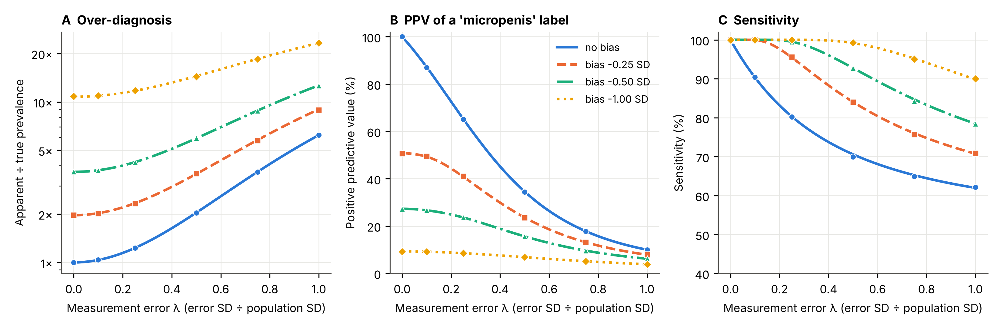
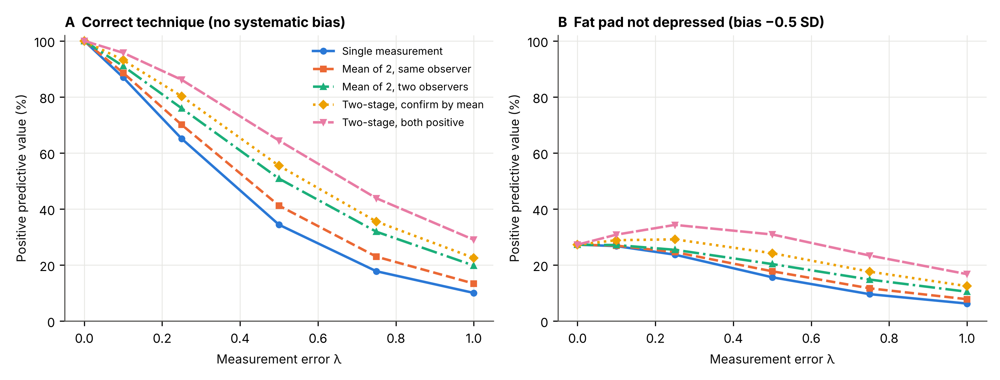
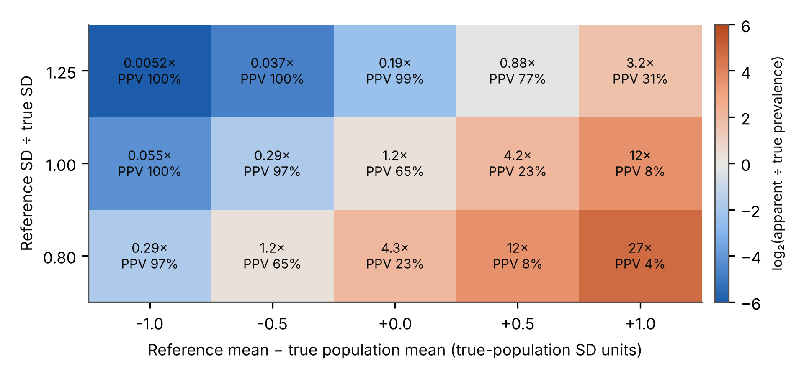

# The right count, the wrong children: a Monte Carlo study of measurement error, suprapubic fat and reference mismatch in the diagnosis of micropenis

**Authors:** [Author 1]^1^, … [Senior author]^1^

^1^ [Department of Pediatric Endocrinology, Institution, City, Country]

**Correspondence:** [name, e-mail]

**Word count:** ~4,600 (main text); **Tables:** 3; **Figures:** 3; **Supplementary:** code and full results

---

## Abstract

**Background.** Micropenis is diagnosed when stretched penile length (SPL) falls more than 2.5 SD below the reference mean. Only about 0.6% of a normal distribution lies beyond this threshold, which makes it unusually sensitive to measurement error. Measurement error itself has never been formally propagated into diagnostic accuracy.

**Methods.** We conducted a Monte Carlo simulation study designed and reported according to the ADEMP framework, simulating 4 × 10^6 boys in each of 73 scenarios. True SPL was generated on a standardised scale. Observed SPL added four components:

- random error (λ, error SD as a fraction of the population SD), partitioned into within- and between-examiner components;
- child-specific systematic bias (δ), representing incomplete fat-pad depression or sub-maximal stretch;
- reference-population mismatch;
- departures from normality.

We estimated apparent prevalence, sensitivity, positive predictive value (PPV), false positives per 10,000 boys and regression to the mean. Estimates were computed for a single measurement and for four replicate-based strategies. Single-measurement results were validated against closed-form solutions.

**Results.**

- *Random error, single measurement.* With λ = 0.25, apparent prevalence rose 1.23-fold and the PPV was 65%. With λ = 0.5 it doubled (2.04-fold), the PPV fell to 34% and sensitivity was 70%. With λ = 1.0, prevalence was inflated 6.2-fold and the PPV was 10%.
- *Systematic bias.* A bias of −0.5 SD inflated prevalence 3.7-fold even with error-free measurement (PPV 27%). Combined with λ = 0.5, inflation was 5.9-fold and the PPV 16%.
- *Replicate strategies.* Averaging two independent examiners raised the PPV at λ = 0.5 from 34% to 51%. A two-stage rule requiring both examiners to fall below threshold raised it to 64%, at the cost of sensitivity (51%). No replicate strategy corrected a bias shared by both examiners.
- *Reference mismatch.* A reference whose mean exceeded the true population mean by 0.5 SD inflated prevalence 4.2-fold.
- *Matched-error reference.* When the reference itself carried the same error as the clinical measurement, apparent prevalence was exactly nominal, yet only 51% of flagged boys (λ = 0.5) truly lay below −2.5 SD.
- *Regression to the mean.* Boys flagged on one measurement "gained" 0.58 SD on untreated re-measurement by another examiner when λ = 0.5. This is about 2.3 mm in a newborn.
- *Empirical error levels.* Published newborn reliability data imply λ of about 0.25 under optimised conditions and up to about 0.6 in routine practice. Measuring in the first 12 hours of life introduces a bias of about −1 SD.

**Conclusions.** At the −2.5 SD threshold, measurement error that would be negligible elsewhere on the growth chart determines who receives the diagnosis. Technique-related bias cannot be averaged away. A single measurement should never establish micropenis. Uncontrolled before–after studies of hormonal treatment must be interpreted in the light of regression to the mean.

**Keywords:** micropenis; stretched penile length; measurement error; misclassification; regression to the mean; Monte Carlo simulation; obesity; diagnostic accuracy

### What is already known

- Micropenis is defined statistically, as SPL below −2.5 SD. SPL measurement depends on technique, including fat-pad depression and degree of stretch.

### What this study adds

- An error SD of half the population SD doubles the apparent prevalence of micropenis, and two of three boys so labelled are misclassified.
- Systematic under-measurement, for example from an undepressed suprapubic fat pad, is the dominant source of over-diagnosis. Repeating the same flawed technique does not correct it.
- Selection on a single low value produces substantial spurious "growth" on re-measurement. This biases uncontrolled treatment studies.

---

## 1. Introduction

Stretched penile length is the single measurement on which the diagnosis of micropenis rests. The conventional threshold, 2.5 SD below the mean for age, is embedded in consensus statements on differences of sex development [@Lee2006; @Ahmed2021] and in clinical reviews [@Hatipoglu2013; @Wiygul2011]. The diagnosis carries weight. In a newborn boy, micropenis may be the first sign of congenital hypogonadotropic hypogonadism or combined pituitary hormone deficiency [@Boehm2015; @Grumbach2005]. It prompts investigation during minipuberty [@KuiriHanninen2014] and, increasingly, early hormonal intervention [@Bouvattier2011].

The −2.5 SD convention, however, places the threshold in a part of the distribution where measurement error has disproportionate consequences. Only 0.62% of a normal population lies below −2.5 SD. Because the density of the distribution falls steeply in the tail, many more boys lie just above the threshold than just below it. Any random error therefore pushes more true-normal boys below the threshold than it pushes true-tail boys above it. Systematic error does the same, more efficiently.

Anthropometrists have long recognised that measurement error degrades the classification of nutritional status at extreme cut-offs [@Ulijaszek1999]. Statisticians have described the associated regression to the mean [@Barnett2005]. Neither insight has been applied quantitatively to penile measurement.

The problem is not hypothetical. SPL measurement involves at least three steps that vary between examiners:

1. the force with which the suprapubic fat pad is depressed;
2. the degree of stretch applied;
3. the reading at the tip of the glans.

The first step has acquired new importance with the rise of childhood obesity, because suprapubic fat systematically shortens the measured length if it is not fully displaced. Moreover, the references in clinical use were derived in different populations and decades, with incompletely described technique [@Feldman1975; @Boas2006; @Schonfeld1942]. Their reported dispersion is itself uncertain: the classic newborn standard was summarised as "3.5 cm plus or minus 0.7 cm" [@Feldman1975], whereas a large contemporary cohort reported 3.49 ± 0.4 cm [@Boas2006].

We therefore asked how much each of four factors distorts the apparent prevalence and diagnostic accuracy of the −2.5 SD rule:

- random measurement error;
- systematic technique bias;
- reference mismatch;
- distributional shape.

We also asked which practical measurement strategies mitigate the distortion. Because the threshold is defined in SD units, we worked on the standardised scale, which makes the results applicable to any age and any reference. We then translated them into centimetres for the newborn.

---

## 2. Methods

The study was planned and reported according to the ADEMP framework (aims, data-generating mechanisms, estimands, methods, performance measures) for simulation studies [@Morris2019; @Burton2006].

### 2.1 Aims

1. To quantify the effect on the −2.5 SD diagnosis of random measurement error, systematic technique bias, reference mismatch and non-normality.
2. To compare replicate-measurement strategies.
3. To quantify regression to the mean after selection on a single measurement.

### 2.2 Data-generating mechanisms

For boy *i*, true SPL is expressed on the standardised scale of the true population distribution, so that z~i~ ~ N(0, 1).

Observed SPL from examiner *j*, replicate *r*, is

y~ijr~ = z~i~ + d~i~ + b~j~ + e~ijr~,

where:

- b~j~ ~ N(0, λ~b~²) is the examiner's systematic deviation;
- e~ijr~ ~ N(0, λ~w~²) is within-examiner error;
- d~i~ ~ N(δ, σ~δ~²) is a child-specific technique bias, shared across examiners who use the same flawed technique.

Total random error is λ² = λ~b~² + λ~w~², and φ = λ~b~²/λ² is the between-examiner share. The clinician standardises against a reference with mean shifted by Δ and SD scaled by κ, both relative to the true population. The child is classified as positive if (y − Δ)/κ < −2.5.

Six experiments were run (Table 1). The number of scenarios in each is given in the table.

**Table 1. Simulation experiments.**

| Experiment | Factors varied | Fixed | Scenarios |
|---|---|---|---|
| A. Error × bias | λ ∈ {0, 0.1, 0.25, 0.5, 0.75, 1.0} × δ ∈ {0, −0.25, −0.5, −1.0} | φ = 0.5, σ~δ~ = 0, Δ = 0, κ = 1 | 24 |
| B. Heterogeneous bias | λ ∈ {0.25, 0.5} × (δ, σ~δ~) ∈ {(−0.5, 0.25), (−0.5, 0.5), (−1.0, 0.5)} | φ = 0.5 | 6 |
| C. Examiner share | λ ∈ {0.25, 0.5, 0.75} × φ ∈ {0, 0.5, 0.8} | δ = 0 | 9 |
| D. Reference mismatch | Δ ∈ {−1, −0.5, 0, 0.5, 1} × κ ∈ {0.8, 1.0, 1.25} | λ = 0.25, δ = 0 | 15 |
| E. Skewness | λ ∈ {0, 0.25, 0.5} × skew-normal shape α ∈ {−3, −1.5, 0, 1.5, 3} (standardised to mean 0, SD 1) | δ = 0 | 15 |
| F. Matched-error reference | λ ∈ {0.25, 0.5, 0.75, 1.0}; κ = √(1 + λ²), Δ = 0 | δ = 0 | 4 |

### 2.3 Estimands

The target condition was true SPL below −2.5 SD (z~i~ < −2.5). The estimands were:

- apparent prevalence (test-positive proportion) and its ratio to true prevalence (the "inflation ratio");
- sensitivity, specificity, PPV and NPV;
- false positives per 10,000 boys;
- the expected change on untreated re-measurement among boys flagged by a single measurement (regression to the mean), both by the same examiner and by a different one.

### 2.4 Methods (diagnostic strategies) compared

- **S1.** A single measurement.
- **S2.** The mean of two replicates by the same examiner.
- **S3.** The mean of two measurements by two independent examiners.
- **S4.** A two-stage rule. A second examiner measures only if S1 is positive, and the final result is positive if the mean of both measurements is below threshold.
- **S5.** A two-stage rule requiring both examiners to fall below the threshold.

### 2.5 Performance measures and validation

Each scenario simulated 4 × 10^6 boys, giving about 24,800 true-tail boys per scenario. Monte Carlo standard errors were computed for all proportions. Under normality, S1 results were compared with closed-form solutions:

- apparent prevalence = Φ((−2.5κ + Δ − δ)/√(1 + λ² + σ~δ~²));
- the joint probability of true and apparent positivity, by one-dimensional numerical integration;
- regression to the mean, which for independent re-measurement equals −E[y | y < c] · λ²/(1 + λ²).

The number of independent measurements required to reach a target PPV was obtained analytically. The simulation used Python 3.13 (NumPy 2.5, SciPy 1.18), with a fixed seed (20261118). The full code and output are provided as supplementary material.

### 2.6 Clinical anchoring

To translate standardised results into centimetres, we used the newborn SD of 0.4 cm reported in a cohort of 1,962 boys [@Boas2006]. On this scale, λ = 0.25, 0.5 and 1.0 correspond to error SDs of 1, 2 and 4 mm. δ = −0.5 SD corresponds to a systematic under-measurement of 2 mm. Empirical estimates of SPL measurement error and fat-pad effects from the literature are summarised in Section 3.7 [ANCHOR].

---

## 3. Results

### 3.1 Validation

Across 61 normal-model scenarios, Monte Carlo and closed-form estimates of apparent prevalence agreed within sampling error: the largest absolute standardised difference was 2.43, consistent with chance across 61 comparisons. The largest absolute difference in PPV was 0.005. The simulated regression to the mean (0.579 SD at λ = 0.5) matched the analytic value (0.578 SD).

### 3.2 Random error alone

Random error alone produced steep over-diagnosis (Table 2; Figure 1).

- **λ = 0.25** (1 mm in a newborn): apparent prevalence rose from 0.62% to 0.76%, an inflation ratio of 1.23. One in three positives was false (PPV 65%), and one in five true-tail boys was missed (sensitivity 80%).
- **λ = 0.5** (2 mm): apparent prevalence doubled (1.26%; ratio 2.04). The PPV fell to 34%, giving 83 false positives per 10,000 boys.
- **λ = 1.0**: inflation was 6.2-fold and the PPV was 10%.

Sensitivity fell with error even though apparent prevalence rose. This is because true-tail boys are concentrated just below the threshold; even at λ = 0.1, 10% of them were missed.

**Table 2. Single-measurement accuracy of the −2.5 SD rule, by random error (λ) and systematic bias (δ).** Values are from simulation with 4 × 10^6 boys per cell. True prevalence is 0.62% in all cells.

| λ | δ (SD) | Apparent prevalence (%) | Inflation | Sensitivity (%) | PPV (%) | False positives / 10,000 |
|---|---|---|---|---|---|---|
| 0 | 0 | 0.62 | 1.00 | 100 | 100 | 0 |
| 0.25 | 0 | 0.76 | 1.23 | 80.2 | 65.1 | 27 |
| 0.50 | 0 | 1.26 | 2.04 | 70.0 | 34.4 | 83 |
| 0.75 | 0 | 2.26 | 3.66 | 64.9 | 17.8 | 186 |
| 1.00 | 0 | 3.84 | 6.20 | 62.1 | 10.0 | 345 |
| 0 | −0.25 | 1.23 | 1.97 | 100 | 50.6 | 60 |
| 0 | −0.50 | 2.26 | 3.67 | 100 | 27.3 | 164 |
| 0 | −1.00 | 6.69 | 10.8 | 100 | 9.2 | 607 |
| 0.25 | −0.50 | 2.62 | 4.20 | 99.5 | 23.7 | 200 |
| 0.50 | −0.50 | 3.68 | 5.94 | 92.7 | 15.6 | 311 |
| 0.50 | −1.00 | 9.00 | 14.4 | 99.3 | 6.9 | 838 |
| 1.00 | −1.00 | 14.44 | 23.3 | 90.0 | 3.9 | 1,388 |

### 3.3 Systematic technique bias

Systematic bias was the more potent distortion.

- **Bias without random error.** A uniform under-measurement of 0.25 SD, about 1 mm in a newborn, doubled apparent prevalence (ratio 1.97; PPV 51%). A bias of 0.5 SD inflated it 3.7-fold (PPV 27%), and a bias of 1 SD inflated it 10.8-fold (PPV 9%).
- **Bias combined with random error.** The effects compounded: δ = −0.5 with λ = 0.5 gave 5.9-fold inflation and a PPV of 16%.
- **Heterogeneous bias.** When the bias varied between children, as fat-pad thickness does, inflation increased further. With δ = −0.5 SD, σ~δ~ = 0.5 and λ = 0.5, apparent prevalence was 5.1% (8.3-fold) and the PPV was 10%.

### 3.4 Mitigation strategies

Replicate strategies helped against random error but not against systematic bias (Table 3; Figure 2).

At λ = 0.5 without bias, the PPV was:

- 34% for a single measurement;
- 41% for two replicates by the same examiner;
- 51% for two independent examiners;
- 55% for two-stage confirmation by the mean;
- 64% for two-stage both-positive.

The two-stage rules required second measurements in only 126 of every 10,000 boys. The both-positive rule, however, reduced sensitivity to 51%.

**Examiner share.** The benefit of same-examiner replication shrank as the between-examiner share of error rose. At λ = 0.5, its PPV was 51% when all error was within-examiner (φ = 0) and 37% when φ = 0.8. The two-examiner mean was unaffected by φ (PPV 51%).

**Shared bias.** When both examiners shared a bias of −0.5 SD, no strategy brought the PPV above 35% at any λ ≥ 0.25 (Figure 2B).

**Replicates required.** Analytically, at λ = 0.5, the number of independent measurements needed was 2 to reach a PPV of 50%, 5 to reach 67% and 12 to reach 80%. At λ = 0.25 the corresponding numbers were 1, 2 and 3.

**Table 3. Comparison of measurement strategies at λ = 0.5.**

| Strategy | δ = 0: Sens (%) | δ = 0: PPV (%) | δ = 0: FP/10,000 | δ = −0.5: Sens (%) | δ = −0.5: PPV (%) | δ = −0.5: FP/10,000 |
|---|---|---|---|---|---|---|
| S1 Single | 70.0 | 34.4 | 83 | 92.7 | 15.6 | 311 |
| S2 Mean of 2, same examiner | 72.2 | 41.2 | 64 | 95.1 | 17.7 | 273 |
| S3 Mean of 2, two examiners | 75.1 | 50.8 | 45 | 97.4 | 20.3 | 236 |
| S4 Two-stage, mean | 63.0 | 55.4 | 31 | 91.7 | 24.2 | 178 |
| S5 Two-stage, both positive | 51.3 | 64.4 | 18 | 86.1 | 30.9 | 119 |

### 3.5 Reference mismatch and distributional shape

**Reference mismatch** (λ = 0.25; Figure 3):

- A reference whose mean was 0.5 SD above the true population mean inflated apparent prevalence 4.2-fold (PPV 23%). At +1.0 SD the inflation was 11.8-fold (PPV 8%).
- A reference whose mean was 0.5 SD below the true mean reduced apparent prevalence to 0.29 of the true value. Seventy-one per cent of true-tail boys were then missed.
- A reference SD 20% narrower than the truth (κ = 0.8) inflated prevalence 4.3-fold.

**Distributional shape.** Under skewness, the "−2.5 SD" threshold no longer corresponds to the 0.62nd centile: the true prevalence below it ranged from 0.02% (right-skew, α = 3) to 1.67% (left-skew, α = −3). Right skew also magnified the effect of error. With α = 3 and λ = 0.5, inflation was 17.8-fold and the PPV was 3%.

### 3.6 Matched-error references and regression to the mean

**Matched-error references.** When the reference SD contained the same error as the clinical measurement (κ = √(1 + λ²)), apparent prevalence returned to nominal (ratio 0.99–1.01). Classification of individual boys remained poor. Sensitivity and PPV were equal, by construction, at:

- 73% for λ = 0.25;
- 51% for λ = 0.5;
- 35% for λ = 0.75;
- 24% for λ = 1.0.

The count was right; the children were not.

**Regression to the mean.** Among boys flagged by a single measurement, untreated re-measurement by an independent examiner yielded a mean apparent gain of:

- 0.17 SD at λ = 0.25;
- 0.58 SD at λ = 0.5;
- 1.07 SD at λ = 0.75.

For a newborn, these gains are 0.7, 2.3 and 4.3 mm. The SD of the individual change was 0.67 SD at λ = 0.5. Re-measurement by the same examiner halved the apparent gain when φ = 0.5 and reduced it to 0.12 SD when φ = 0.8. In that case the examiner's systematic error is carried into the second measurement, so the apparent stability conceals the bias rather than correcting it.

### 3.7 Empirical anchoring

We systematically searched PubMed for paediatric SPL reliability and technique studies (search log in Supplementary File S2). The search identified 12 paediatric in-vivo studies, and they locate clinical practice squarely within the range in which misclassification is substantial. Where a study reports an intraclass or reliability coefficient R, λ = √(1/R − 1).

**Random error under research conditions.** Goel et al. studied 433–449 boys aged 0–14 years, measured by trained examiners using a standardised technique that included fat-pad depression [@Goel2024]. Inter-observer TEM was 0.10–0.12 cm in boys under 4 years, and intra-observer TEM was 0.07–0.08 cm. Against a newborn SD of 0.40 cm this corresponds to λ ≈ 0.25–0.30. λ is lower at older ages, where the population SD of SPL is larger.

**Random error in newborn practice.** Three studies give estimates:

- *Japan.* In 73 term newborns measured by two observers, the 95% confidence intervals of the limits of agreement were −0.58 to −0.40 cm and 0.33 to 0.51 cm [@Matsuo2014]. The midpoints imply limits of about −0.49 and +0.42 cm and an SD of differences of about 0.23 cm. The single-measurement inter-observer error SD is therefore about 0.16 cm. Against the SD of 0.26 cm reported in the same population, λ ≈ 0.63; against 0.40 cm, λ ≈ 0.41.
- *Mexico.* In 781 newborns, the replicate reliability of SPL was 0.78 [@RomanoRiquer2007], implying λ ≈ 0.53.
- *Italy.* A three-centre study reported an inter-examiner ICC of 0.945 (95% CI 0.768–0.998) [@Righi2026], implying λ ≈ 0.24, though with wide uncertainty.

Plausible values of λ for a single newborn measurement therefore range from about 0.25 under optimised conditions to about 0.6 in routine practice. Under our model these correspond to positive predictive values between about 65% and 25% (Figure 1B).

**Systematic error.** Biases of the magnitudes we modelled are documented:

- *Timing after birth.* Measurement at 1–12 hours of age gave lengths 0.22–0.34 cm shorter (95% CI of the difference) than measurement at 1–7 days [@Matsuo2014]. In a population with an SD of 0.26 cm this is a bias of about −1 SD. In our model, a bias of this size inflates apparent prevalence about ten-fold when an early measurement is compared with a reference obtained later.
- *Arousal and anaesthesia.* Mean SPL was 0.48 cm longer under general anaesthesia than at an awake clinic examination in the same boys [@Akyuz2020].
- *Fat pad.* In a study of 2,010 boys aged 0–18 years that compared lengths with and without fat-pad compression, only the real (fat-pad-compressed) maximal stretched length was free of significant inter-observer variation [@Gabrich2007].

**Clinical referral series.** These series show the expected signature of over-diagnosis:

- Of 96 boys referred to an endocrine service for "micropenis", 41 (42.7%) had a buried penis related to obesity [@Khadilkar2025].
- In another series, 16 of 83 referrals had an SPL within the reference range [@Oyenusi2025].
- In a third, 20 of 65 referred boys (31%) did not have micropenis on specialist examination [@Aslan2013].

These referral PPVs (57%, 81% and 69%) are not directly comparable with our measurement-based estimates, because referrals are often prompted by visual impression rather than measurement. They are, however, of the same order.

---

## 4. Discussion

### 4.1 Principal findings

This simulation shows that the −2.5 SD definition of micropenis is fragile in a precise and quantifiable sense. At that threshold, random error of a magnitude that would be dismissed as trivial elsewhere has large consequences. An error SD of 2 mm in a newborn doubles the number of boys labelled and leaves two of every three labels wrong.

A systematic under-measurement of the same size, the typical result of not pressing the ruler fully to the pubic bone, is worse still. Repeated measurement cannot rescue it, because the error is reproduced with each repetition.

Even the best case has an uncomfortable corollary. When the reference carries the same error as the clinic, the expected count of diagnoses is correct, yet half the boys who receive the diagnosis are not those who truly have the shortest penises.

### 4.2 The arithmetic of the tail

The arithmetic is not exotic, and the mechanism is the one that inflates the apparent prevalence of stunting or obesity at extreme anthropometric cut-offs [@Ulijaszek1999]. The tail of a normal distribution is approximately exponential. Between −2.5 and −3.0 SD the density falls by a factor of about four. Noise added to every boy therefore moves far more boys from the shoulder into the tail than out of it.

Sensitivity falls simultaneously because true-tail boys are crowded against the threshold: their mean distance below it is only about 0.32 SD. The result is the counter-intuitive combination of more diagnoses and more missed diagnoses.

### 4.3 Systematic bias, adiposity and the limits of averaging

Systematic bias deserves particular attention because of obesity. Suprapubic fat conceals the proximal shaft. Unless the fat pad is depressed to the pubic bone, the measured length reflects fat thickness as well as penile size.

Our heterogeneous-bias experiment models exactly this. The bias is larger in some children than others and is not removed by a second examiner who uses the same technique. A clinic serving many children with obesity can therefore generate referrals for "micropenis" at several times the expected rate. The excess arises not because the children's penile size is abnormal but because their adiposity is.

Replication reduces random error, and a second, independent examiner removes examiner-specific bias. Neither addresses bias built into the technique. The remedy for the latter is a standardised technique enforced by training and certification, not more measurements.

### 4.4 Reference mismatch

Reference mismatch acts as a systematic bias at the level of the population. A reference derived from a population with a mean 0.5 SD higher than the local population quadruples the apparent prevalence, and the reverse error hides most true cases. Systematic differences in mean SPL of this order between populations have been reported repeatedly; our companion meta-analysis (Paper 1) quantifies them.

Clinicians who apply a single historical reference worldwide are therefore exposed to an error that no bedside technique can correct. Local, technique-matched references are the only solution. The companion SPL-REF protocol (Paper 5) is designed to provide them, together with an explicit error model.

### 4.5 Regression to the mean and treatment studies

Regression to the mean has implications beyond diagnosis. Most evidence for the hormonal treatment of micropenis comes from uncontrolled before–after series (Paper 2). In those series, boys are enrolled because a measurement fell below a threshold [@Barnett2005].

Our results show that such selection alone produces an apparent gain of about 0.6 SD on re-measurement at plausible error levels. In a newborn this is about 2 mm, before any treatment effect and before any physiological growth.

The bias is smaller when the same examiner re-measures, but only because that examiner's own systematic error is carried forward. The bias is largest precisely when outcome assessment is independent, which is otherwise the methodological ideal. Treatment effects should therefore be estimated against concurrent controls, or at minimum against a baseline obtained independently of the selection measurement.

### 4.6 Strengths and limitations

**Strengths.**

- The study follows a pre-specified ADEMP design.
- Very large Monte Carlo samples were used; the uncertainty in the tail estimates is negligible.
- Every single-measurement result was validated against a closed-form solution.
- Working on the standardised scale makes the results independent of any particular reference.

**Limitations.**

- The target condition is statistical: true SPL below −2.5 SD. It is not a clinical diagnosis. Some boys with pathological micropenis lie far below the threshold and will be detected regardless of error, so for them our sensitivity estimates are conservative. Conversely, our PPV estimates refer to statistical, not pathological, micropenis.
- Errors were modelled as normal and independent of true size. Error proportional to size, or bias that depends on true length, would alter the magnitudes but not the direction of the findings.
- The values of λ and δ were chosen to span the plausible range, not estimated from a single study. Section 3.7 relates them to the available empirical data. Those data are sparse and heterogeneous. The best-quality estimate comes from a single centre with trained examiners [@Goel2024] and is therefore probably optimistic. Published reliability coefficients are of unspecified type, and no paediatric study has directly quantified the fat-pad-depression difference by adiposity. A definitive error model requires a dedicated reliability study (Paper 5).

### 4.7 Recommendations

1. **No diagnosis on one measurement.** A diagnosis of micropenis should not rest on a single measurement. Use the two-stage rule: a second, independent, trained examiner measures whenever the first value falls below the threshold. This costs about 1.3–3.7 extra measurements per 100 boys at λ = 0.5, depending on the bias scenario, and roughly halves the false-positive rate.
2. **Enforced fat-pad technique.** Depression of the suprapubic fat pad to the pubic bone must be explicit, trained and audited, with particular vigilance in children with overweight or obesity.
3. **Matched references.** References should be matched to the population and the technique, and should report their own measurement error.
4. **Controlled treatment studies.** Treatment studies should use concurrent controls or independent baseline measurement, and should report the number of baseline measurements.

### 4.8 Conclusion

At the −2.5 SD threshold, measurement quality, not penile size, may determine who is diagnosed with micropenis. The fix is methodological: certified technique, a second independent examiner, and references that disclose their error.

---

## Declarations

**Funding:** [None / to be completed.]

**Competing interests:** [To be completed.]

**Data and code availability:** All code and full scenario-level output (`simulate.py`, `figures.py`, `simulation_results.csv`, `validation_s1_vs_analytic.csv`, `analytic_grid_s1.csv`, `replicates_needed.csv`) are provided as supplementary material. Results are exactly reproducible with seed 20261118.

**Ethics:** Not applicable (simulation study, no human data).

**Author contributions:** [CRediT taxonomy.]

---

## References

[@REFLIST]

---

## Figure legends

**Figure 1.** Single-measurement accuracy of the −2.5 SD rule as a function of random measurement error (λ = error SD ÷ population SD), for four levels of systematic technique bias (δ).

- (A) Inflation of apparent prevalence relative to true prevalence (logarithmic axis).
- (B) Positive predictive value.
- (C) Sensitivity.

Lines show closed-form results; markers show Monte Carlo estimates (4 × 10^6 boys per scenario). Monte Carlo standard errors are smaller than the markers.

**Figure 2.** Positive predictive value of five measurement strategies across levels of random error.

- (A) No systematic bias.
- (B) A shared systematic bias of −0.5 SD, representing failure to depress the suprapubic fat pad.

Replication improves PPV against random error but cannot correct bias shared between measurements.

**Figure 3.** Effect of reference mismatch on apparent prevalence (inflation factor) and positive predictive value, at λ = 0.25. The x-axis gives the difference between the reference mean and the true population mean, in true-population SD units; the y-axis gives the ratio of the reference SD to the true SD. Colour encodes log~2~(inflation): orange indicates over-diagnosis, blue under-diagnosis and grey nominal.

