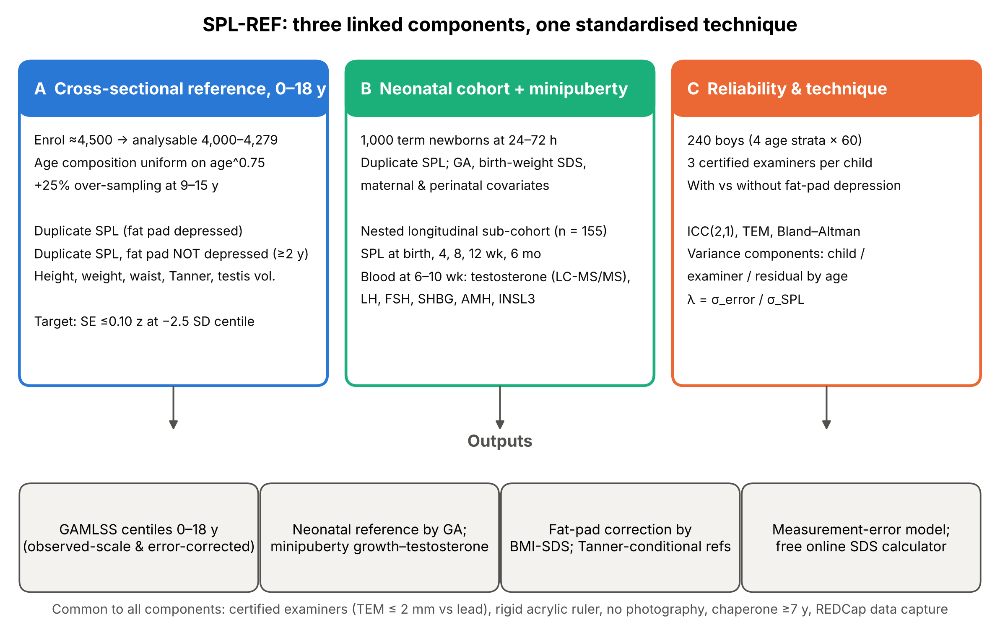

# Error-quantified reference centiles for stretched penile length from birth to 18 years: protocol for the multicentre SPL-REF study

**Authors:** [Author 1]^1^, [Author 2]^2^, … [Senior author]^1^

^1^ [Department of Pediatric Endocrinology, Institution, City, Country]; ^2^ […]

**Correspondence:** [name, address, e-mail]

**Word count:** ~5,200 (main text); **Tables:** 4; **Figures:** 1

**Protocol version:** 1.0, [date]. **Registration:** [ClinicalTrials.gov / OSF Registries identifier — to be obtained before first enrolment]

---

## Abstract

**Introduction.** Stretched penile length (SPL) is the cardinal measurement in the evaluation of micropenis, a sign that may herald congenital hypogonadotropic hypogonadism, combined pituitary hormone deficiency or a difference of sex development. The references in clinical use derive largely from small, single-population samples collected decades ago with incompletely described technique. None quantifies measurement error, although the diagnostic threshold sits at −2.5 SD, a region of the distribution where modest error produces gross misclassification. No widely used reference accounts for suprapubic adiposity, which increasingly confounds the examination of children with obesity.

**Methods and analysis.** SPL-REF is a multicentre study with three linked components. (A) A cross-sectional reference sample of approximately 4,500 healthy boys aged 0–18 years. Age composition is optimised for precision at the extreme centiles, with pubertal over-sampling. (B) A neonatal cohort of 1,000 term newborns, measured at 24–72 hours of life. It contains a nested longitudinal minipuberty sub-cohort of 155 infants, followed to 6 months with serum testosterone and gonadotropins at 6–10 weeks. (C) A reliability and technique sub-study of 240 boys, each measured by three trained examiners, with and without depression of the suprapubic fat pad. Measurement follows a single standardised technique, and every child is measured in duplicate. Centiles will be estimated with generalised additive models for location, scale and shape (GAMLSS). Duplicate and multi-examiner data will be used to estimate age-specific measurement-error variance. Two sets of centiles will be produced: "observed-scale" centiles for single clinical measurements and error-corrected centiles. The primary sample size targets a standard error of ≤0.10 z-units for the −2.5 SD centile.

**Ethics and dissemination.** Approval will be sought from each site's research ethics committee. Parental consent and age-appropriate assent are mandatory. No photographs of the genitalia will be taken. Results will be published open access, with GAMLSS parameter tables and a free online SDS calculator.

**Keywords:** stretched penile length; micropenis; reference centiles; GAMLSS; measurement error; minipuberty; obesity; protocol

### Strengths and limitations of this study

- This is the first SPL reference designed from the outset to quantify and correct for measurement error. It uses duplicate measurements in every child and a three-examiner reliability sub-study.
- Sample size and age composition are derived from formal centile-precision theory, not convention, and target the −2.5 SD threshold itself.
- Paired measurements with and without fat-pad depression allow an adiposity-specific correction to be derived for children with obesity.
- A nested minipuberty sub-cohort links early penile growth to the postnatal androgen surge measured by LC-MS/MS.
- **Limitation:** recruitment through clinical and well-child settings, not population sampling, may introduce selection bias. Multicentre ancestry diversity is limited to the participating sites. Pubertal-age references remain conditional on Tanner stage, which is examiner-assessed.

---

## 1. Introduction

### 1.1 Clinical rationale

Micropenis is conventionally defined as an SPL more than 2.5 SD below the mean for age, in an otherwise normally formed penis [1,2]. The finding matters because it is often the earliest, and sometimes the only, visible sign of deficient fetal and neonatal androgen action. Its causes include congenital hypogonadotropic hypogonadism (CHH), combined pituitary hormone deficiency, partial androgen insensitivity and other differences of sex development [3–5]. In CHH the first months of life offer a diagnostic window, because the postnatal activation of the hypothalamic–pituitary–gonadal axis ("minipuberty") can be interrogated directly [5,6]. They also offer a therapeutic window: early gonadotropin replacement is under active investigation [7]. Whether a newborn boy is investigated therefore depends on a single centimetre measurement compared against a reference.

### 1.2 Limitations of existing references

The references in widespread use have important limitations.

- **Feldman and Smith (1975).** This classic newborn standard reported a stretched length of "3.5 cm plus or minus 0.7 cm" in term infants [8]. Whether the dispersion term denotes one SD or a wider interval is not stated in the abstract. This ambiguity matters: depending on the reading, the −2.5 SD threshold lies anywhere between about 1.75 cm and 2.5 cm.
- **Boas et al. (2006).** This much larger longitudinal study of 1,962 Danish and Finnish boys reported 3.49 ± 0.4 cm at birth and 4.53 ± 0.51 cm at 3 years. It also showed that penile length and growth correlate with serum testosterone during minipuberty [9]. Its authors note, however, that it constitutes a reference for Caucasian boys up to 3 years of age.
- **Later childhood and adolescence.** Here clinicians frequently fall back on mid-20th-century data [10], collected without modern anthropometric standardisation.

### 1.3 Measurement error at the −2.5 SD threshold

No existing reference reports the measurement error with which it was built. Anthropometric error is ordinarily treated as a nuisance [11], but its consequences are disproportionate at a −2.5 SD threshold. Only about 0.6% of a normal distribution lies below that point, so even random error that is small relative to the population SD moves many more children below the threshold than it moves above it.

In a companion Monte Carlo study (Paper 4 of this series), random error of half the population SD doubled the apparent prevalence of micropenis. It lowered the positive predictive value of a single measurement to about one-third. A systematic under-measurement of 0.5 SD, of the magnitude produced by failure to depress the suprapubic fat pad, inflated apparent prevalence approximately four-fold.

A reference that does not quantify the error of its own measurements cannot tell the clinician how far to trust a measurement near the threshold.

### 1.4 Adiposity

The rising prevalence of childhood obesity adds a specific, directional bias. Suprapubic fat conceals the penile shaft, and incomplete depression of the fat pad shortens the measured length. Under-measurement is therefore concentrated in exactly the children most likely to be referred with "small penis". No reference provides an adiposity-specific correction.

### 1.5 Objectives

**Primary objective.** To construct age-specific SPL reference centiles from birth to 18 years, with precision at the −2.5 SD centile of ≤0.10 z-units, using a single standardised technique.

**Secondary objectives.**

1. To quantify within- and between-examiner measurement error across age, and to derive error-corrected centiles.
2. To construct a term-neonatal SPL reference, adjusted for gestational age and birth-weight SDS.
3. To model penile growth velocity through minipuberty, and its association with serum testosterone, LH and FSH at 6–10 weeks.
4. To quantify the effect of fat-pad depression on measured SPL as a function of BMI-SDS, and to derive a correction.
5. To construct Tanner-stage-conditional references for ages 9–18 years.
6. To quantify the misclassification that results from applying existing references to the study population.

---

## 2. Methods and analysis

### 2.1 Design overview

SPL-REF is a prospective, multicentre observational study with three linked components (Figure 1):

- **Component A — cross-sectional reference sample** (0–18 years; target analysable n = 4,000, enrolment n ≈ 4,500).
- **Component B — neonatal cohort** (term newborns at 24–72 h; n = 1,000), with a nested **longitudinal minipuberty sub-cohort** (n = 155 enrolled; visits at birth, 4, 8 and 12 weeks and 6 months).
- **Component C — reliability and technique sub-study** (n = 240; 60 in each of four age strata; three examiners per child; paired measurements with and without fat-pad depression).

The study will be reported according to STROBE [12]. This protocol follows the structure recommended by SPIRIT where applicable to observational designs [13].

**Figure 1.** Study schema: Components A–C, their sample sizes, measurement schedules and analytic outputs.

### 2.2 Setting and recruitment

Participants will be recruited at [k] centres in [country/countries]. Each site will recruit through settings in which an external genital examination is already part of routine care, so that the study adds no examination that would not otherwise occur:

- maternity wards (Component B);
- well-child and immunisation clinics;
- general paediatric outpatient clinics;
- pre-operative assessment for minor surgery remote from the genitalia and inguinal region (for example, adenotonsillectomy or dental procedures under general anaesthesia).

Consecutive eligible boys within pre-specified age-band quotas (Table 1) will be approached. A recruitment log of all approached families, with reasons for non-participation, will be kept so that selection can be described.

### 2.3 Eligibility

**Inclusion criteria**

- Male sex assigned at birth.
- Age 0–18 years (Component A), or term birth (≥37+0 weeks' gestation) and age 24–72 h (Component B).
- Written informed consent from a parent or guardian, and assent or consent from the child as appropriate to age.

**Exclusion criteria**

- Any known or suspected difference of sex development.
- Hypospadias of any degree; epispadias.
- Bilateral cryptorchidism. A unilateral undescended testis is recorded and the child is analysed in sensitivity analyses only.
- Known endocrine disorder, including CHH, hypopituitarism, congenital adrenal hyperplasia, growth hormone deficiency or treatment, and thyroid disease under treatment.
- Current or past exposure to exogenous androgens, oestrogens, aromatase inhibitors, GnRH analogues or systemic glucocorticoids for more than 2 weeks.
- A recognised genetic syndrome; chronic disease affecting growth.
- Prior genital surgery other than circumcision. Circumcision status is recorded.

In Component A, children born preterm are eligible but are analysed with gestational age as a covariate up to 2 years of corrected age. Concealed (buried) or webbed penis is **not** an exclusion criterion: excluding it would truncate the very distribution in which adiposity effects operate. It is recorded as a structured variable.

### 2.4 Measurement protocol

#### 2.4.1 Standard technique

All measurements use a single technique, specified in a laminated bedside card and a training video.

1. **Position and environment.** The child lies supine, in a warm room (22–26 °C), with a parent present and, for children aged 7 years and older, a chaperone.
2. **Instrument.** A rigid, transparent acrylic ruler graduated in millimetres, with the zero mark at the end of the ruler and no dead space. Each ruler is checked against a calibrated steel rule at the start of every session.
3. **Fat-pad depression.** The ruler is placed on the dorsum of the penis and pressed firmly against the pubic symphysis until bony resistance is felt, so that the suprapubic fat pad is fully depressed.
4. **Stretch.** The glans is grasped between thumb and forefinger and the penis is stretched along the ruler, perpendicular to the plane of the pubis. Stretch continues to the point of increased resistance, defined as the point beyond which further traction produces discomfort or no further lengthening.
5. **Reading.** Length is read from the pubic bone to the tip of the glans. The foreskin is excluded. The reading is taken at eye level, to the nearest millimetre.
6. **Duplicate measurement.** The examiner releases the penis, waits at least 30 seconds and repeats steps 3–5. An assistant records both values; the examiner does not see the first value before taking the second. If the two values differ by more than 3 mm, a third measurement is taken. The child's SPL is the mean of the two closest values. All raw values are retained.

#### 2.4.2 Fat-pad-not-depressed length

In every child aged 2 years or older (Component A) and in all Component C participants, a second pair of measurements is taken. The ruler rests on the skin surface without compression, which reproduces the most common technical error. This yields a paired difference for each child (Section 2.7.5).

#### 2.4.3 Accompanying measurements

The following are recorded for each child:

- recumbent length (under 2 years) or standing height, to 0.1 cm;
- weight, to 0.01 kg (infants) or 0.1 kg;
- waist circumference (2 years and older);
- testicular volume by Prader orchidometer;
- Tanner genital and pubic-hair stage (9 years and older, or earlier if signs of puberty are present);
- circumcision status;
- presence and grade of concealed penis;
- for Component B: gestational age (by first-trimester ultrasound), birth weight, birth length, mode of delivery, maternal pre-pregnancy BMI, gestational diabetes, maternal smoking, and use of assisted reproduction.

Self-reported parental ancestry is recorded using categories pre-specified for each site.

#### 2.4.4 Photography

No photographs of the genitalia will be taken at any stage. Image-based measurement is explicitly outside the scope of this protocol.

### 2.5 Examiner training, certification and quality control

Examiners are paediatric endocrinologists, paediatricians, paediatric nurses or neonatologists.

- **Training.** Each examiner completes a training module (video plus supervised practice).
- **Certification.** Each examiner then measures 10 children alongside a site lead examiner. Certification requires a technical error of measurement (TEM) against the lead of ≤2 mm, and no systematic bias exceeding 1 mm (paired t-test).
- **Re-certification.** Every 6 months.
- **Ongoing monitoring.** Each examiner's running mean SPL z-score, calculated against the interim GAMLSS model, is plotted on a cumulative-sum chart. A drift of more than 0.3 z-units triggers retraining.

This approach adapts the anthropometric standardisation procedures of the WHO Multicentre Growth Reference Study [14] to a genital measurement.

### 2.6 Component B: neonatal cohort and minipuberty sub-cohort

**Neonatal cohort.** Term newborns are measured once, between 24 and 72 hours of life, using the standard technique (Section 2.4.1).

**Minipuberty sub-cohort.** Infants whose parents consent to longitudinal follow-up are measured again at 4, 8 and 12 weeks and at 6 months (±7 days at each visit). A venous or capillary blood sample (≤1.5 mL) is taken at 6–10 weeks, the window of the postnatal testosterone peak [6,9]. The sample is analysed for:

- total testosterone by LC-MS/MS;
- LH, FSH, SHBG, AMH and INSL3, by validated immunoassays.

Samples are processed within 2 hours and stored at −80 °C. The time of sampling is recorded.

### 2.7 Statistical analysis

All analyses will be performed in R (packages *gamlss*, *lme4*, *mice*). Code will be version-controlled and released with the publications. A statistical analysis plan will be finalised before the database lock for Component A.

#### 2.7.1 Primary analysis: GAMLSS centiles (Component A)

Centiles will be estimated with GAMLSS [15,16]. GAMLSS generalises the LMS method [17] and was the framework used for the WHO Child Growth Standards [18,19].

- **Candidate distributions:** Box–Cox Cole–Green (BCCG), Box–Cox t (BCT) and Box–Cox power exponential (BCPE).
- **Age scale:** age is entered on a transformed scale, age^ξ, with ξ estimated by profile GAIC.
- **Smoothing:** each distribution parameter (μ, σ, ν, τ) is modelled with a penalised B-spline. Effective degrees of freedom are selected by GAIC(κ), with κ ∈ {2, 3, log n}. The model is chosen on GAIC(3) unless diagnostics favour an alternative.
- **Diagnostics:**
  - worm plots by age group;
  - Q-statistics;
  - empirical centile coverage: the observed proportion of children below the fitted 0.6th, 2nd, 10th, 50th, 90th, 98th and 99.4th centiles, within pre-specified tolerance (Table 3).
- **Uncertainty:** 95% confidence bands for the −2.5 SD centile curve are obtained by non-parametric bootstrap (2,000 resamples), stratified by site and age band.

For ages 0–24 months, models are refitted with gestational age as a covariate on μ, to provide a reference corrected for gestational age.

#### 2.7.2 Measurement-error model and error-corrected centiles

The duplicate measurements in every child (Component A) and the three-examiner design (Component C) allow the total observed variance to be partitioned. For child i, examiner j and replicate r:

y~ijr~ = θ~i~ + b~j~ + e~ijr~,  with b~j~ ~ N(0, σ~b~²) and e~ijr~ ~ N(0, σ~w~²).

Here θ~i~ is the child's true SPL, σ~b~² is between-examiner variance and σ~w~² is within-examiner variance. Variance components are estimated by REML in age-stratified linear mixed models. The error SD, σ~e~(age), is then smoothed across age.

Two sets of centiles will be published:

1. **Observed-scale centiles.** These are fitted to single-measurement values, so the reference SD contains the same error a clinician makes when measuring once. Apparent prevalence is then nominal when the clinician's error matches the study's error. Individual misclassification is not removed: the companion simulation showed that, with matched error of half the population SD, only about half of the boys falling below the threshold truly lie below it.
2. **Error-corrected centiles.** The GAMLSS σ curve is deconvolved as σ~true~²(age) = σ~obs~²(age) − σ~e~²(age)/m, where m is the number of measurements averaged. These centiles describe the distribution of true SPL. They are the appropriate comparator for research and for averaged measurements obtained under certified conditions.

The publication will include guidance on which set to use, given how many measurements a clinician takes and whether the clinician is certified.

#### 2.7.3 Neonatal reference (Component B)

Neonatal SPL will be modelled by linear (or GAMLSS, if non-normal) regression on gestational age (37–42 weeks), birth-weight SDS and postnatal age in hours. Mean, SD and the −2.5 SD threshold will be reported overall and by gestational week, with bootstrap 95% confidence intervals. Neonatal values will be compared with Feldman and Smith [8] and Boas et al. [9] by applying their thresholds to our cohort and reporting the proportion of boys classified below each.

#### 2.7.4 Minipuberty growth and hormones (Component B sub-cohort)

SPL trajectories from birth to 6 months will be modelled with linear mixed-effects models. The models will include random intercepts and slopes, and natural-spline terms for age. Penile growth velocity from 0 to 12 weeks will be regressed on log-transformed testosterone at 6–10 weeks. Models will be adjusted for gestational age, birth-weight SDS and exact sampling age. LH and FSH will be analysed analogously. The pre-specified primary association is the Pearson correlation between log-testosterone and 0–12-week SPL velocity.

#### 2.7.5 Fat-pad effect and adiposity correction

For each child, the difference D = SPL(fat pad depressed) − SPL(not depressed) will be modelled with GAMLSS against age and BMI-SDS (WHO references [19,20]), with waist-to-height ratio as an alternative adiposity metric. The output is a table of expected D, with prediction intervals, by age and BMI-SDS category. It allows a clinician to judge how much of an apparently short penis in a child with obesity is attributable to unreduced suprapubic fat. Children with concealed penis will be analysed both within the model and as a separate stratum.

#### 2.7.6 Pubertal references

For ages 9–18 years, Tanner-stage-conditional distributions will be estimated: one GAMLSS model per genital stage G1–G5, with age as covariate within stage. Age-only centiles conflate differences in pubertal timing with differences in size. Testicular volume will be examined as an alternative maturational covariate.

#### 2.7.7 Reliability (Component C)

The following will be reported, overall and by age stratum (neonate; 1–5 years; 6–10 years prepubertal; 11–18 years):

- ICC(2,1) and ICC(2,3): two-way random effects, absolute agreement [21];
- the within-examiner and between-examiner SDs and the TEM [11];
- Bland–Altman limits of agreement between examiners [22];
- the ratio λ = σ~e~/σ~SPL~, which links directly to the misclassification estimates of the companion simulation.

#### 2.7.8 Heterogeneity between sites and ancestry groups

Site and parental-ancestry group will be added as random effects on μ and, separately, on σ. A population-specific reference will be produced if the between-group SD of the median exceeds 0.25 z-units, a threshold chosen because systematic shifts of this size materially change apparent prevalence. Otherwise a single pooled reference will be presented.

#### 2.7.9 Missing data

SPL itself will not be imputed. Missing covariates will be multiply imputed by chained equations (20 imputations) when more than 5% of values are missing. Sensitivity analyses will be restricted to complete cases.

#### 2.7.10 Pre-specified sensitivity analyses

1. Exclusion of children with concealed penis.
2. Exclusion of children with a unilateral undescended testis.
3. Exclusion of circumcised boys.
4. Use of the first measurement only, rather than the mean of duplicates.
5. Exclusion of each site in turn.

### 2.8 Sample size

#### 2.8.1 Component A

Cole showed that, with GAMLSS smoothing, a cross-sectional sample of 6,878 boys aged 0–21 years estimated the 2nd and 98th centiles with a standard error of 0.066 z-units. Smoothing increased the effective sample size two- to three-fold compared with a naive per-age calculation [23].

The asymptotic standard error of a normal quantile at z~p~ is proportional to √(1 + z~p~²/2). The −2.5 SD centile is therefore 1.15 times harder to estimate than the 2nd centile (z = −2.054). Scaling Cole's result (SE ∝ n^−½):

- SE ≤ 0.10 z at the −2.5 SD centile requires approximately **3,975** boys;
- SE ≤ 0.08 requires approximately 6,211;
- SE ≤ 0.12 requires approximately 2,761 (Table 1).

We target **4,000 analysable** participants. To allow for 10% unusable records, we will enrol **4,500**. For comparison, a naive unsmoothed design would require 413 boys in every age window to achieve the same precision.

**Age composition.** Cole further showed that, for the extreme centiles, ages should be sampled uniformly on the age^0.75 scale [23]. Applied to 0–18 years, this allocation appears in Table 1. Because between-child variance is greatest during gonadarche, the 9–15-year bands are over-sampled by 25%. This brings the analysable total to 4,279.

Precision for infancy is not left to Component A alone. Under the age^0.75 allocation only about 71 boys would fall in the first month of life, so neonatal precision is provided separately by Component B.

**Table 1. Component A: target analysable sample by age band.** Allocation is uniform on age^0.75 over 0–18 years, with 25% over-sampling at 9–15 years.

| Age band | Proportion (age^0.75) | n (base allocation) | n (with pubertal over-sampling) |
|---|---|---|---|
| 0–1 mo | 1.8% | 71 | 71 |
| 1–6 mo | 5.0% | 201 | 201 |
| 6–12 mo | 4.6% | 186 | 186 |
| 1–2 y | 7.8% | 312 | 312 |
| 2–5 y | 19.0% | 761 | 761 |
| 5–9 y | 21.2% | 848 | 848 |
| 9–11 y | 9.7% | 386 | 483 |
| 11–13 y | 9.2% | 369 | 462 |
| 13–15 y | 8.9% | 355 | 444 |
| 15–18 y | 12.8% | 511 | 511 |
| **Total** | 100% | **4,000** | **4,279** |

Precision targets for the −2.5 SD centile, scaled from Cole [23]:

| Target SE (z-units) | n required |
|---|---|
| 0.12 | 2,761 |
| 0.10 | 3,975 |
| 0.08 | 6,211 |

#### 2.8.2 Component B

The newborn SD is approximately 0.4 cm [9]. With n = 1,000:

- the mean is estimated to ±0.025 cm (95% CI half-width);
- the −2.5 SD threshold is estimated to ±0.050 cm, assuming normality.

Precision at other sample sizes is shown in Table 2.

**Minipuberty sub-cohort.** Boas et al. reported r = 0.31 between serum testosterone and penile length [9]. We power the sub-cohort for a more conservative r = 0.25 between log-testosterone and 0–12-week SPL velocity (two-sided α = 0.05, power 0.80), which requires **124** infants. Allowing 20% attrition, we will enrol **155**. Powering for r = 0.20 would require 194 infants and is not proposed.

**Table 2. Component B: precision of neonatal estimates.** Assumes SD = 0.40 cm.

| n | 95% CI half-width, mean (cm) | 95% CI half-width, −2.5 SD threshold (cm) |
|---|---|---|
| 500 | 0.035 | 0.071 |
| 750 | 0.029 | 0.058 |
| 1,000 | 0.025 | 0.050 |
| 1,500 | 0.020 | 0.041 |

#### 2.8.3 Component C

**ICC precision.** Using Bonett's approximation for a two-way design with k = 3 examiners [24], 64 children per stratum estimate an ICC of 0.90 with a 95% CI width of 0.08. Sixty children per stratum (240 in total) give a width of about 0.082. For hypothesis testing (H~0~: ρ = 0.75 vs H~1~: ρ = 0.90; one-sided α = 0.05, power 0.80), Walter et al.'s method requires only 19 children [25]. The design is therefore driven by precision, not by testing.

**Error-SD precision.** With 240 children × 3 examiners there are 480 degrees of freedom. The within-child error SD is then estimated to within −6%/+7% (95% CI multipliers 0.94–1.07). The 95% CI of each Bland–Altman limit of agreement is ±0.22 SD~diff~ [22].

**Fat-pad slope.** The fat-pad analysis will draw on all Component A children aged 2 years and older (expected about 3,500; Table 1). Even under conservative assumptions (residual SD of the paired difference 0.6 cm; SD of BMI-SDS 1.2), 265 children give 90% power to detect a slope of 0.10 cm per BMI-SDS unit. The study is therefore heavily over-powered for this objective, which will instead be reported with precision-based inference.

All calculations are reproducible from the code supplied with this protocol (`code/sample_size.py`).

### 2.9 Data management

Data will be entered directly into a REDCap database hosted by the coordinating centre [26]. The database will have range checks; for example, SPL values outside the age-specific 0.1st–99.9th centile of the interim model trigger a query. Raw duplicate values, examiner identifiers and ruler identifiers are stored for every child. Hormone results are uploaded by the laboratory and linked by study identifier. Pseudonymised data are held separately from identifiers. Access is role-based.

### 2.10 Patient and public involvement

A parent advisory group, including parents of boys with micropenis and of boys with obesity, will be convened before ethics submission. It will review the participant information materials, specifically:

- the wording used to describe the genital examination;
- the arrangements for a chaperone;
- the option for adolescents to choose the sex of the examiner where possible.

The group will also review lay summaries of the results. *[Authors: replace with a description of the involvement that actually took place before submission. Journals require this statement to be factual.]*

---

## 3. Ethics and dissemination

### 3.1 Approvals and consent

Ethical approval will be obtained from the research ethics committee of each participating site before enrolment.

**Consent.** Written informed consent is obtained from a parent or guardian. In addition:

- children aged 7–12 years give verbal assent, documented by the examiner;
- adolescents aged 13–17 years give written assent, or written consent where local law permits.

**Conduct of the examination.**

- The examination is performed only in a private room, with a parent present.
- A chaperone is present from age 7 years.
- The examination can be declined or stopped at any time without consequence for clinical care.
- Adolescents are offered the choice of the examiner's sex where staffing permits.

**Photography.** No photographs are taken.

**Incidental findings.** Any child found to have SPL below −2.5 SD on the interim reference, cryptorchidism, hypospadias not previously known, or other genital anomaly is referred, with parental consent, to paediatric endocrinology or paediatric urology through a pre-specified pathway. The parents are informed sensitively, by a clinician.

### 3.2 Risks and burden

The measurement is non-invasive and adds approximately 3 minutes to a routine examination. In the minipuberty sub-cohort, the single blood sample (≤1.5 mL) will be taken by experienced paediatric phlebotomists, with topical anaesthesia offered.

### 3.3 Dissemination

Results will be published in open-access journals. The full GAMLSS parameter tables (μ, σ, ν, τ by age) and the measurement-error variance function will be included as supplementary data, so that any clinician or software developer can compute SDS. A free, anonymous online SPL-SDS calculator will be released. It will follow the same no-data-retention design as the investigators' existing IGF-1 timing calculator. It will offer both the observed-scale and the error-corrected reference, with guidance on which to use. De-identified individual-level data will be available to bona fide researchers on reasonable request, after approval by the steering committee.

### 3.4 Study status and timeline

| Milestone | Planned date |
|---|---|
| Ethics approvals | [month/year] |
| Examiner certification | [month/year] |
| Component B recruitment | [12 months] |
| Component A and C recruitment | [24 months] |
| Database lock | [month/year] |
| Primary publication | [month/year] |

---

## Declarations

**Author contributions:** [CRediT taxonomy to be completed.]

**Funding:** [To be completed.] The funder will have no role in design, conduct, analysis or reporting.

**Competing interests:** [To be completed.]

**Data sharing:** See Section 3.3.

**Acknowledgements:** [To be completed.]

---

## References

1. Lee PA, Houk CP, Ahmed SF, Hughes IA. Consensus statement on management of intersex disorders. International Consensus Conference on Intersex. Pediatrics. 2006;118(2):e488-500. doi:10.1542/peds.2006-0738 PMID: 16882788.
2. Hatipoğlu N, Kurtoğlu S. Micropenis: etiology, diagnosis and treatment approaches. J Clin Res Pediatr Endocrinol. 2013;5(4):217-23. doi:10.4274/Jcrpe.1135 PMID: 24379029.
3. Boehm U, Bouloux PM, Dattani MT, de Roux N, Dodé C, Dunkel L, et al. Expert consensus document: European Consensus Statement on congenital hypogonadotropic hypogonadism--pathogenesis, diagnosis and treatment. Nat Rev Endocrinol. 2015;11(9):547-64. doi:10.1038/nrendo.2015.112 PMID: 26194704.
4. Ahmed SF, Achermann J, Alderson J, Crouch NS, Elford S, Hughes IA, et al. Society for Endocrinology UK Guidance on the initial evaluation of a suspected difference or disorder of sex development (Revised 2021). Clin Endocrinol (Oxf). 2021;95(6):818-840. doi:10.1111/cen.14528 PMID: 34031907.
5. Grumbach MM. A window of opportunity: the diagnosis of gonadotropin deficiency in the male infant. J Clin Endocrinol Metab. 2005;90(5):3122-7. doi:10.1210/jc.2004-2465 PMID: 15728198.
6. Kuiri-Hänninen T, Sankilampi U, Dunkel L. Activation of the hypothalamic-pituitary-gonadal axis in infancy: minipuberty. Horm Res Paediatr. 2014;82(2):73-80. doi:10.1159/000362414 PMID: 25012863.
7. Bouvattier C, Maione L, Bouligand J, Dodé C, Guiochon-Mantel A, Young J. Neonatal gonadotropin therapy in male congenital hypogonadotropic hypogonadism. Nat Rev Endocrinol. 2011;8(3):172-82. doi:10.1038/nrendo.2011.164 PMID: 22009162.
8. Feldman KW, Smith DW. Fetal phallic growth and penile standards for newborn male infants. J Pediatr. 1975;86(3):395-8. doi:10.1016/s0022-3476(75)80969-3 PMID: 1113226.
9. Boas M, Boisen KA, Virtanen HE, Kaleva M, Suomi AM, Schmidt IM, et al. Postnatal penile length and growth rate correlate to serum testosterone levels: a longitudinal study of 1962 normal boys. Eur J Endocrinol. 2006;154(1):125-9. doi:10.1530/eje.1.02066 PMID: 16382001.
10. Schonfeld WA, Beebe GW. Normal growth and variation in the male genitalia from birth to maturity. J Urol. 1942;48:759-77. †
11. Ulijaszek SJ, Kerr DA. Anthropometric measurement error and the assessment of nutritional status. Br J Nutr. 1999;82(3):165-77. doi:10.1017/s0007114599001348 PMID: 10655963.
12. von Elm E, Altman DG, Egger M, Pocock SJ, Gøtzsche PC, Vandenbroucke JP, et al. The Strengthening the Reporting of Observational Studies in Epidemiology (STROBE) statement: guidelines for reporting observational studies. Lancet. 2007;370(9596):1453-7. doi:10.1016/S0140-6736(07)61602-X PMID: 18064739.
13. Chan AW, Tetzlaff JM, Altman DG, Laupacis A, Gøtzsche PC, Krleža-Jerić K, et al. SPIRIT 2013 statement: defining standard protocol items for clinical trials. Ann Intern Med. 2013;158(3):200-7. doi:10.7326/0003-4819-158-3-201302050-00583 PMID: 23295957.
14. de Onis M, Onyango AW, Van den Broeck J, Chumlea WC, Martorell R. Measurement and standardization protocols for anthropometry used in the construction of a new international growth reference. Food Nutr Bull. 2004;25(1 Suppl):S27-36. doi:10.1177/15648265040251S104 PMID: 15069917.
15. Rigby RA, Stasinopoulos DM. Generalized additive models for location, scale and shape. J R Stat Soc Ser C Appl Stat. 2005;54(3):507-54. †
16. Stasinopoulos DM, Rigby RA. Generalized additive models for location scale and shape (GAMLSS) in R. J Stat Softw. 2007;23(7):1-46. †
17. Cole TJ, Green PJ. Smoothing reference centile curves: the LMS method and penalized likelihood. Stat Med. 1992;11(10):1305-19. doi:10.1002/sim.4780111005 PMID: 1518992.
18. Borghi E, de Onis M, Garza C, Van den Broeck J, Frongillo EA, Grummer-Strawn L, et al. Construction of the World Health Organization child growth standards: selection of methods for attained growth curves. Stat Med. 2006;25(2):247-65. doi:10.1002/sim.2227 PMID: 16143968.
19. WHO Multicentre Growth Reference Study Group. WHO Child Growth Standards based on length/height, weight and age. Acta Paediatr Suppl. 2006;450:76-85. doi:10.1111/j.1651-2227.2006.tb02378.x PMID: 16817681.
20. de Onis M, Onyango AW, Borghi E, Siyam A, Nishida C, Siekmann J. Development of a WHO growth reference for school-aged children and adolescents. Bull World Health Organ. 2007;85(9):660-7. doi:10.2471/blt.07.043497 PMID: 18026621.
21. Koo TK, Li MY. A Guideline of Selecting and Reporting Intraclass Correlation Coefficients for Reliability Research. J Chiropr Med. 2016;15(2):155-63. doi:10.1016/j.jcm.2016.02.012 PMID: 27330520.
22. Bland JM, Altman DG. Statistical methods for assessing agreement between two methods of clinical measurement. Lancet. 1986;1(8476):307-10. PMID: 2868172.
23. Cole TJ. Sample size and sample composition for constructing growth reference centiles. Stat Methods Med Res. 2021;30(2):488-507. doi:10.1177/0962280220958438 PMID: 33043801.
24. Bonett DG. Sample size requirements for estimating intraclass correlations with desired precision. Stat Med. 2002;21(9):1331-5. doi:10.1002/sim.1108 PMID: 12111881.
25. Walter SD, Eliasziw M, Donner A. Sample size and optimal designs for reliability studies. Stat Med. 1998;17(1):101-10. doi:10.1002/(sici)1097-0258(19980115)17:1\<101::aid-sim727\>3.0.co;2-e PMID: 9463853.
26. Harris PA, Taylor R, Thielke R, Payne J, Gonzalez N, Conde JG. Research electronic data capture (REDCap)--a metadata-driven methodology and workflow process for providing translational research informatics support. J Biomed Inform. 2009;42(2):377-81. doi:10.1016/j.jbi.2008.08.010 PMID: 18929686.

---

### Table 3. Pre-specified centile-coverage tolerances for model acceptance

Tolerances are based on the binomial 99% interval for n = 4,000. Coverage will also be checked within each age band, using the band-specific binomial interval.

| Fitted centile | Expected % below | Acceptable observed % (overall) |
|---|---|---|
| 0.6th (−2.5 SD) | 0.62 | 0.32–0.98 |
| 2nd | 2.0 | 1.45–2.60 |
| 10th | 10.0 | 8.80–11.25 |
| 50th | 50.0 | 47.98–52.02 |
| 90th | 90.0 | 88.75–91.20 |
| 98th | 98.0 | 97.40–98.55 |

### Table 4. Schedule of assessments

| Assessment | A (single visit) | B neonatal (24–72 h) | B sub-cohort 4 wk | 8 wk | 12 wk | 6 mo | C (single visit) |
|---|---|---|---|---|---|---|---|
| Consent / assent | ✓ | ✓ | | | | | ✓ |
| SPL, duplicate, fat pad depressed | ✓ | ✓ | ✓ | ✓ | ✓ | ✓ | ✓ (×3 examiners) |
| SPL, duplicate, fat pad not depressed | ✓ (≥2 y) | | | | | | ✓ |
| Length/height, weight, waist | ✓ | ✓ | ✓ | ✓ | ✓ | ✓ | ✓ |
| Testicular volume, Tanner stage | ✓ | | | | | | ✓ |
| Perinatal and maternal data | (≤2 y) | ✓ | | | | | |
| Blood: testosterone (LC-MS/MS), LH, FSH, SHBG, AMH, INSL3 | | | | ✓ (6–10 wk) | | | |
